# Series "Chuyện của Mentor Cute" EP.01–EP.20: nội dung bài đăng 16–25/11/2026 (bản 3)

Nguồn: schedule/posts.json. Mỗi bài gồm ngày giờ đăng (giờ Việt Nam), ảnh và caption nguyên văn sẽ đăng. Số liệu trong hình chỉ là số giả định, mang tính tham khảo. Nguồn các trích dẫn: cmo/CMO_FactCheck_2026-11-09.md (phần Bản 2).

| EP | Bài (id) | Ngày | Giờ |
|---|---|---|---|
| EP.01 | 15 | 16/11/2026 | 10:00 |
| EP.02 | 16 | 16/11/2026 | 20:00 |
| EP.03 | 17 | 17/11/2026 | 10:00 |
| EP.04 | 18 | 17/11/2026 | 20:00 |
| EP.05 | 19 | 18/11/2026 | 10:00 |
| EP.06 | 20 | 18/11/2026 | 20:00 |
| EP.07 | 21 | 19/11/2026 | 10:00 |
| EP.08 | 22 | 19/11/2026 | 20:00 |
| EP.09 | 23 | 20/11/2026 | 10:00 |
| EP.10 | 24 | 20/11/2026 | 20:00 |
| EP.11 | 25 | 21/11/2026 | 10:00 |
| EP.12 | 26 | 21/11/2026 | 20:00 |
| EP.13 | 27 | 22/11/2026 | 10:00 |
| EP.14 | 28 | 22/11/2026 | 20:00 |
| EP.15 | 29 | 23/11/2026 | 10:00 |
| EP.16 | 30 | 23/11/2026 | 20:00 |
| EP.17 | 31 | 24/11/2026 | 10:00 |
| EP.18 | 32 | 24/11/2026 | 20:00 |
| EP.19 | 33 | 25/11/2026 | 10:00 |
| EP.20 | 34 | 25/11/2026 | 20:00 |

---

## EP.01 · 16/11/2026 lúc 10:00 (bài 15)

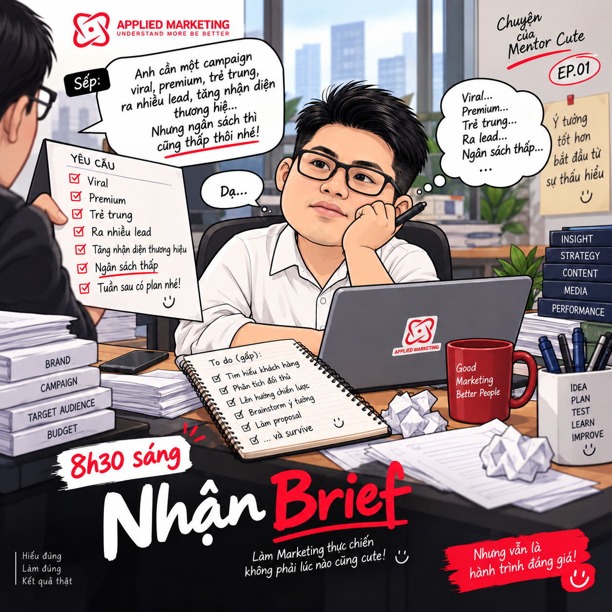

8H30 SÁNG NHẬN BRIEF: VIRAL, PREMIUM, TRẺ TRUNG, NHIỀU LEAD… NGÂN SÁCH THÌ THẤP! 😅  
  
Chuyện của Mentor Cute · EP.01  
  
Một brief đòi tất cả mọi thứ cùng lúc thì có làm nổi không?  
  
Theo mình, câu trả lời là: làm được, nhưng phải đổi cách nhận brief trước đã.  
  
Sáng thứ Hai, 8h30, sếp đưa yêu cầu: chiến dịch phải lan truyền mạnh, sang trọng, trẻ trung, thu về thật nhiều khách để lại thông tin, lại tăng độ nhận biết thương hiệu. À, ngân sách thì “cũng thấp thôi nhé”, và tuần sau có kế hoạch nha! Mentor Cute chỉ đáp “Dạ…” rồi mở sổ ghi việc gấp. 😵  
  
1. Vấn đề: đây mới là danh sách ước mơ, chưa phải brief.  
  
Mỗi mong muốn kéo về một hướng, trong khi tiền và thời gian chỉ có một. Sang trọng thì khó “đại trà”, lan truyền mạnh thì khó giữ vẻ cao cấp, ngân sách thấp thì khó vừa phủ rộng vừa chạm sâu.  
  
2. Hệ quả: càng chăm chỉ càng dễ đi lệch.  
  
Cố làm vừa lòng tất cả, bạn sẽ có một bản đề xuất ôm đồm, không điểm nào thật sự nổi bật. Đến lúc báo cáo, sếp hỏi “sao chưa viral?” cũng không có gì để trả lời.  
  
3. Cách gỡ: dùng 24 giờ đầu để “dọn” brief.  
  
Chọn một mục tiêu chính. Hỏi thẳng sếp: “Nếu chỉ được chọn một, anh muốn nhiều người biết đến hay nhiều người để lại thông tin?”. Phần còn lại là mục tiêu phụ.  
Đổi chữ mơ hồ thành con số. “Nhiều lead” là bao nhiêu người, “ngân sách thấp” là bao nhiêu tiền, “tuần sau” là ngày nào.  
Nói rõ điều phải đánh đổi. Ví dụ giả định: ngân sách nhỏ thì chọn một nhóm khách và một đến hai kênh, thay vì phủ rộng cho loãng.  
Cuối cùng, viết lại brief trong một trang và nhờ sếp xác nhận bằng tin nhắn trước khi bắt tay làm.  
  
Stephen Covey từng đặt một nguyên tắc ngay đầu cuốn The 7 Habits of Highly Effective People: “Begin with the end in mind.” Hiểu theo cách của dân marketing: nhìn thấy đích rồi hãy cất bước, vì chạy rất nhanh về một hướng sai thì chỉ thêm xa đích.  
  
Việc nên làm hôm nay: mở brief gần đây của bạn, gạch chân một mục tiêu chính và ghi ra một thứ sẽ không làm.  
  
Suy cho cùng, một brief tốt không phải brief đòi được nhiều thứ, mà là brief cho cả đội biết rõ mình đang cùng đi về đâu.  
  
Bạn từng nhận brief “muốn tất cả” chưa? Kể mình nghe với nha 👇  
  
---------------------------------  
💎 Applied Marketing – Mentor Xờ & Chạm Marketing  
📞 Hotline & Zalo: 033 955 7573  
🌐 Website: appliedmarketer.com  
#AppliedMarketing #MarketingThucChien #ContentMarketing #Content #DigitalMarketing #HocMarketing #Branding #BrandStrategy

---

## EP.02 · 16/11/2026 lúc 20:00 (bài 16)

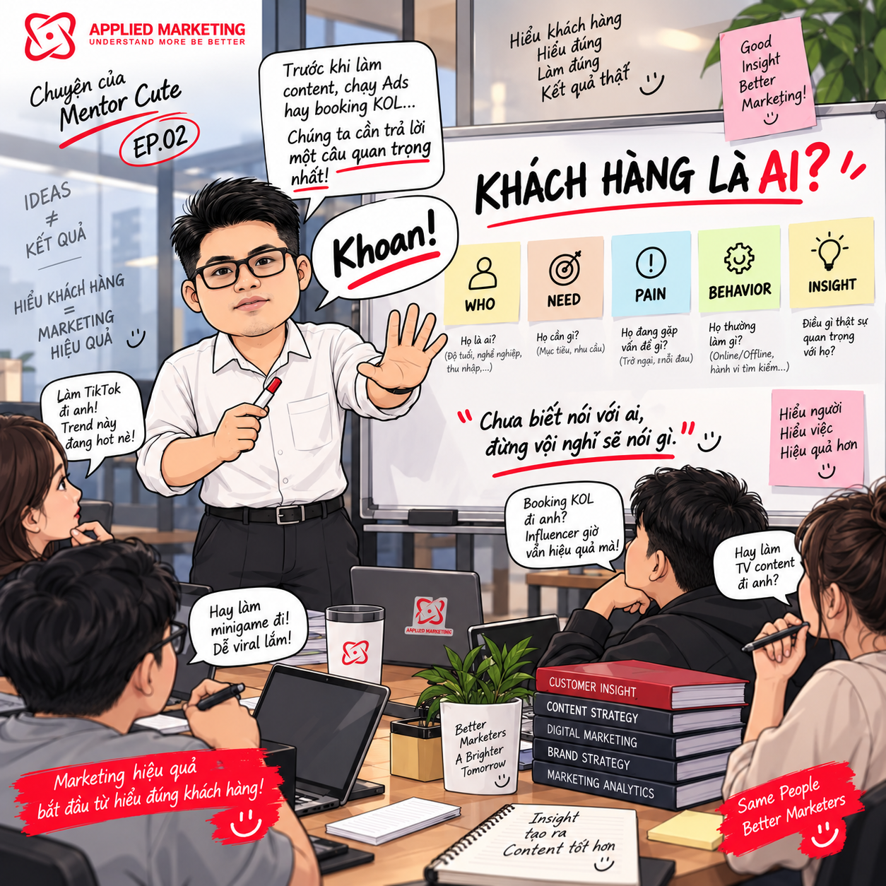

TRƯỚC KHI LÀM CONTENT, CHẠY ADS HAY BOOKING KOL: HÃY “KHOAN!” ✋  
  
Chuyện của Mentor Cute · EP.02  
  
Làm TikTok, booking KOL hay chạy minigame: nên chọn cái nào trước?  
  
Theo mình, đừng chọn vội. Câu hỏi nên đến trước tất cả là: khách hàng của mình thật sự là ai?  
  
Cả nhóm hào hứng lắm: “Làm TikTok đi anh, trend này đang hot nè!”, “Booking KOL (người có sức ảnh hưởng) đi, giờ vẫn hiệu quả mà!”, “Hay làm minigame, dễ viral lắm!”. Mentor Cute giơ tay: “Khoan!”  
  
1. Chọn kênh khi chưa hiểu khách giống như chọn quà cho người mình chưa từng gặp.  
  
Có thể trúng, nhưng phần lớn là may rủi, mà may rủi thì rất tốn tiền. Một chiêu thức đang hot chưa chắc hợp với nhóm khách của bạn.  
  
2. Hiểu khách không cần nghiên cứu cao siêu, chỉ cần trả lời đủ 5 câu.  
  
(Đây là khung mình hay dùng, theo kinh nghiệm của page, không phải quy chuẩn bắt buộc.)  
Who: họ là ai, bao nhiêu tuổi, làm nghề gì, sống ở đâu?  
Need: họ đang muốn đạt điều gì?  
Pain: điều gì đang làm họ vướng, khó chịu?  
Behavior: mỗi ngày họ làm gì, tìm thông tin ở đâu, tin ai?  
Insight: điều họ nghĩ mà ít khi nói ra. Ví dụ giả định: “Tôi muốn bán được hàng, nhưng sợ đăng nhiều bị cho là phiền.”  
  
3. Lấy câu trả lời bằng cách ít tốn kém: nghe khách thật.  
  
Nhắn hỏi 5 khách cũ, đọc lại bình luận và tin nhắn, xem khách hay hỏi gì. Chỉ vài cuộc trò chuyện là bạn đã bớt đoán đi rất nhiều. Sau đó mới chọn kênh: khách của bạn có mặt ở đâu thì mình đến đó.  
  
Peter Drucker, cha đẻ của khoa học quản trị hiện đại, nhìn marketing theo một cách rất giản dị. Trong cuốn Management, ông cho rằng đích đến của marketing là hiểu khách đến mức sản phẩm vừa vặn với họ, vừa vặn tới độ gần như tự nó đi bán: “The aim of marketing is to know and understand the customer so well the product or service fits him and sells itself.” Hiểu đủ sâu thì phần bán hàng nhẹ đi rất nhiều.  
  
Việc nên làm hôm nay: chọn một nhóm khách và trả lời đủ 5 câu trong 15 phút. Câu nào bí, đó là câu bạn cần đi hỏi khách thật.  
  
Bởi suy cho cùng, ý tưởng hay chưa chắc là kết quả; hiểu khách mới là nền để mọi ý tưởng có chỗ đứng.  
  
Bạn trả lời được mấy trong 5 câu? Comment cho mình biết nha 👇  
  
---------------------------------  
💎 Applied Marketing – Mentor Xờ & Chạm Marketing  
📞 Hotline & Zalo: 033 955 7573  
🌐 Website: appliedmarketer.com  
#AppliedMarketing #MarketingThucChien #ContentMarketing #Content #DigitalMarketing #HocMarketing #Branding #BrandStrategy

---

## EP.03 · 17/11/2026 lúc 10:00 (bài 17)

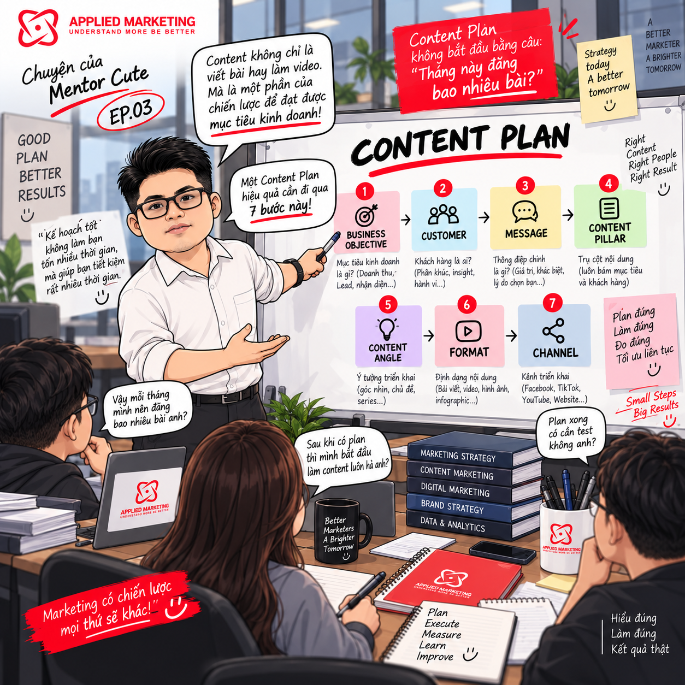

CONTENT PLAN KHÔNG BẮT ĐẦU BẰNG CÂU “THÁNG NÀY ĐĂNG BAO NHIÊU BÀI?” 🗓️  
  
Chuyện của Mentor Cute · EP.03  
  
Trước (Before): cả nhóm hỏi “Vậy mỗi tháng mình nên đăng bao nhiêu bài anh?”. Lịch nội dung được điền kín cho đủ chỉ tiêu, cuối tháng có cả chục bài nhưng không ai trả lời được chúng giúp gì cho việc kinh doanh.  
  
Sau (After): mỗi bài đăng đều có lý do tồn tại. Nhìn vào lịch, bạn biết bài này nói với ai, để họ nhớ điều gì, và dẫn họ tới hành động nào.  
  
Cầu nối (Bridge): đảo thứ tự câu hỏi. Số bài là câu hỏi ở cuối, không phải ở đầu.  
  
Mentor Cute cười và vẽ lên bảng một đường đi gồm 7 bước (quy trình mình hay dùng, theo kinh nghiệm của page):  
  
1. Mục tiêu kinh doanh: viết bằng một câu. Ví dụ giả định: “tăng số khách nhắn tin hỏi mua”.  
2. Khách hàng: nhóm nào, đang gặp vấn đề gì.  
3. Thông điệp chính: một điều duy nhất khách cần nhớ.  
4. Trụ cột nội dung: vài nhóm chủ đề lớn bám sát mục tiêu và khách hàng, như kiến thức, câu chuyện, bằng chứng.  
5. Góc triển khai: mỗi trụ cột có thể kể nhiều kiểu, như mẹo, so sánh, trước và sau.  
6. Dạng nội dung: bài chữ, hình, video ngắn hay infographic (hình tóm tắt thông tin).  
7. Kênh đăng: nơi khách của bạn thật sự có mặt.  
  
Chỉ sau bước 7 mới đến chuyện bao nhiêu bài, đăng lúc nào, ai làm. Rồi thử, đo, chỉnh.  
  
Philip Kotler, người được nhiều người gọi là cha đẻ của marketing hiện đại, trong giáo trình Marketing Management đã mô tả marketing như một nghệ thuật kiêm khoa học: biết chọn đúng thị trường mình phục vụ, rồi có được, giữ chân và làm khách hàng lớn lên bằng giá trị vượt trội mà mình tạo ra và trao đi. Hiểu như vậy thì “đăng bài” chỉ là một mắt xích nhỏ ở cuối chuỗi, không phải toàn bộ câu chuyện.  
  
Việc nên làm hôm nay: trước khi mở lịch đăng, hoàn thành 3 bước đầu trên giấy là mục tiêu, khách hàng và thông điệp.  
  
Một lịch nội dung đẹp không nằm ở số ô được tô màu, mà ở chỗ ô nào cũng dẫn về mục tiêu của doanh nghiệp.  
  
Bạn đang kẹt ở bước nào trong 7 bước? Comment cho mình biết nha 👇  
  
---------------------------------  
💎 Applied Marketing – Mentor Xờ & Chạm Marketing  
📞 Hotline & Zalo: 033 955 7573  
🌐 Website: appliedmarketer.com  
#AppliedMarketing #MarketingThucChien #ContentMarketing #Content #DigitalMarketing #HocMarketing #Branding #BrandStrategy

---

## EP.04 · 17/11/2026 lúc 20:00 (bài 18)

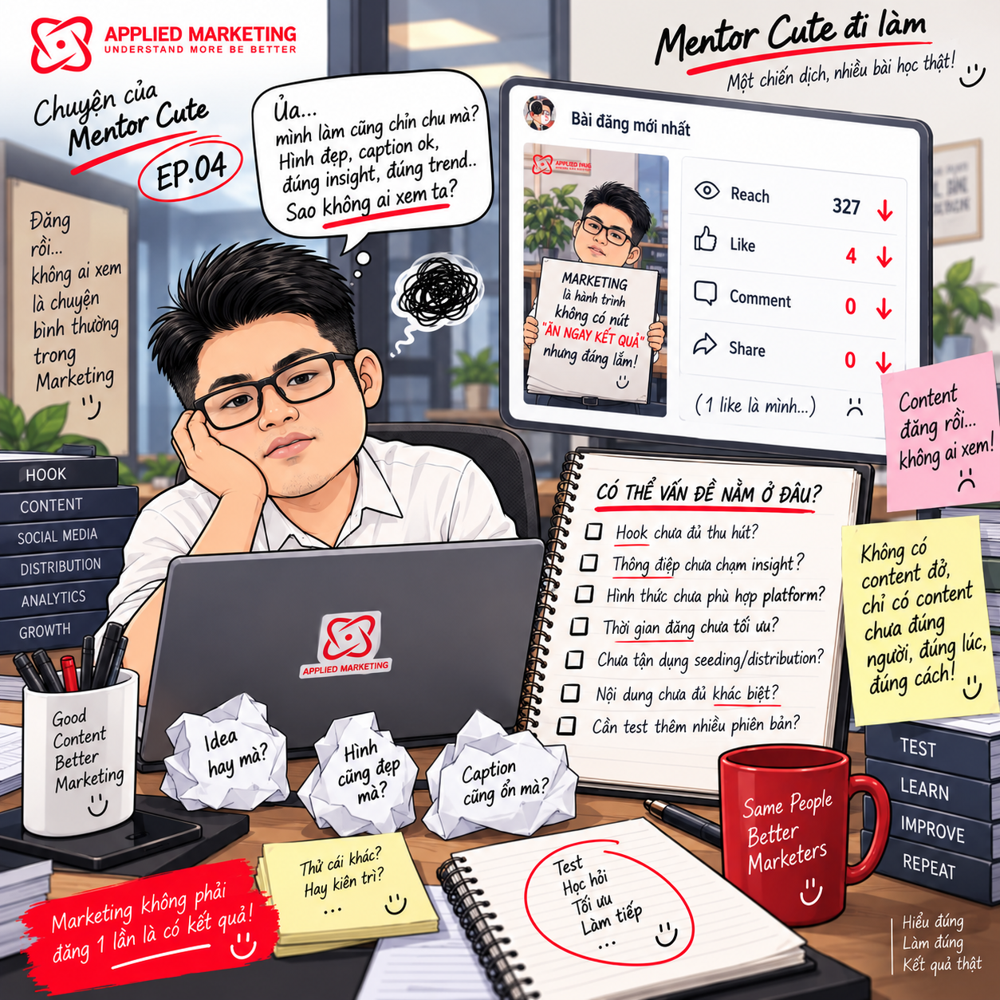

ĐĂNG RỒI MÀ KHÔNG AI XEM: CHUYỆN BÌNH THƯỜNG TRONG MARKETING! 😢  
  
Chuyện của Mentor Cute · EP.04  
  
Chú ý: bạn đã bao giờ đăng một bài thật chỉn chu rồi nhìn con số lẻ tẻ chưa?  
  
Hình đẹp, caption ổn, đúng insight, đúng trend… Mentor Cute nhìn màn hình, số lượt xem đếm trên đầu ngón tay, cái like duy nhất chắc là của chính mình. (Số liệu trong hình là số giả định, chỉ mang tính tham khảo.)  
  
Quan tâm: vì sao chuyện này xảy ra, và có nên bỏ cuộc không?  
  
Bài ít người xem là chuyện rất bình thường. Điều đáng tiếc là nhiều bạn vội kết luận “nội dung mình dở” rồi dừng lại. Trong khi nguyên nhân thường nằm ở vài chỗ rất cụ thể, và chỗ nào cũng sửa được.  
  
Mong muốn: một cách kiểm tra bài từ ngoài vào trong, không cần đoán.  
  
1. Câu mở đầu. Người đang lướt qua có hiểu “bài này dành cho mình, mình được gì” trong vài dòng đầu không? Thử viết 3 câu mở đầu khác nhau cho cùng một bài.  
2. Thông điệp. Bài đang nói điều khách quan tâm hay điều mình muốn nói?  
3. Hình thức. Chữ, hình hay video có hợp nơi đăng và thói quen xem của khách?  
4. Giờ đăng. Xem lúc nào khách của bạn thường online, rồi thử đổi giờ ở vài bài. Mỗi lần chỉ đổi một thứ để biết thứ nào có tác dụng.  
5. Phân phối. Nhờ đồng nghiệp, khách quen, nhóm phù hợp xem và trao đổi trong những giờ đầu, đừng chỉ đăng rồi ngồi chờ.  
6. Điểm khác biệt. Bài này có điều gì người khác chưa nói, hoặc nói theo cách rất riêng của bạn không?  
  
David Ogilvy, một trong những cây đại thụ của ngành quảng cáo, từng nói trong cuốn Confessions of an Advertising Man rằng trung bình số người đọc tiêu đề nhiều gấp năm lần số người đọc phần thân, nên viết xong tiêu đề là bạn đã dùng hết tám phần mười số tiền của mình: “On the average, five times as many people read the headline as read the body copy. When you have written your headline, you have spent eighty cents out of your dollar.” Cho nên đừng tiếc công cho vài dòng đầu tiên.  
  
Hành động: chọn một bài im ắng trong tuần, viết lại 3 tiêu đề, đăng thử bản bạn ưng ý vào một khung giờ khác, rồi ghi lại kết quả.  
  
Một bài đăng chưa phải cả hành trình. Có bài nào của bạn từng im ắng, rồi bạn tìm ra lý do? Chia sẻ để mọi người cùng học nha 👇  
  
---------------------------------  
💎 Applied Marketing – Mentor Xờ & Chạm Marketing  
📞 Hotline & Zalo: 033 955 7573  
🌐 Website: appliedmarketer.com  
#AppliedMarketing #MarketingThucChien #ContentMarketing #Content #DigitalMarketing #HocMarketing #Branding #BrandStrategy

---

## EP.05 · 18/11/2026 lúc 10:00 (bài 19)

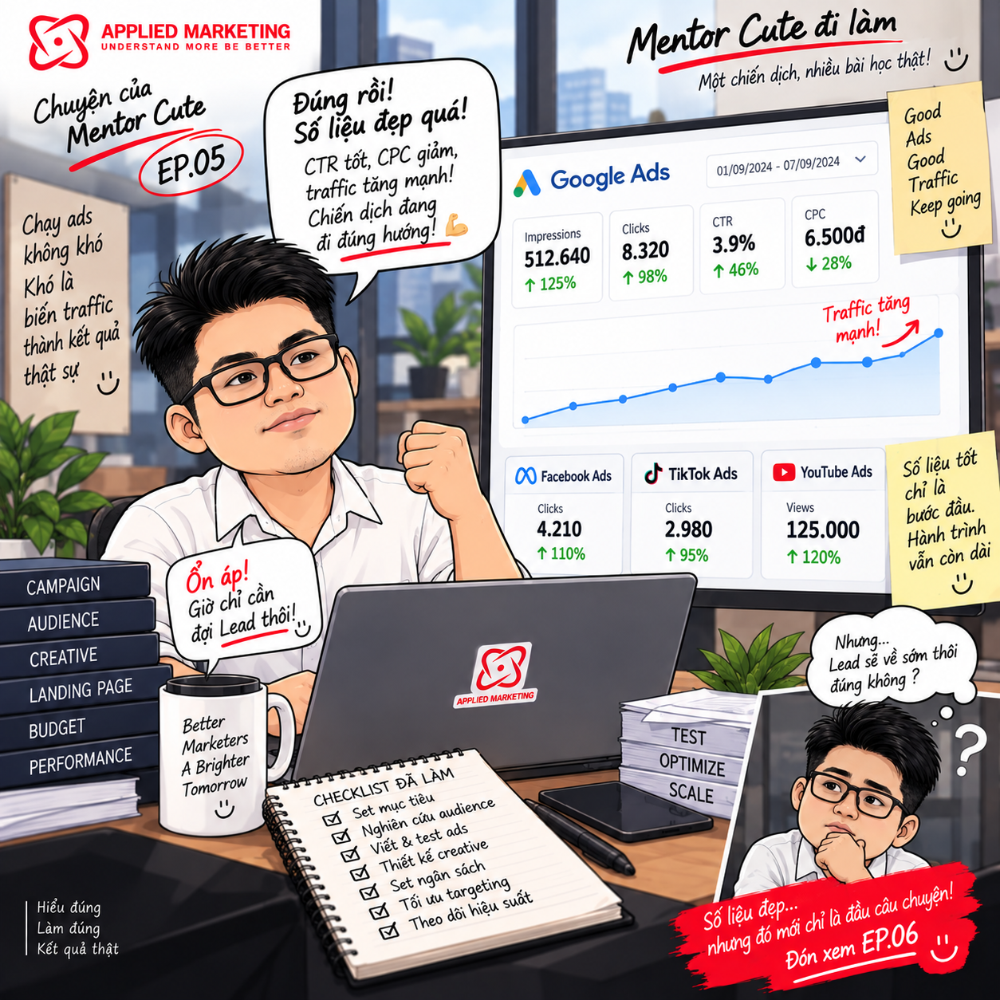

SỐ LIỆU ĐẸP QUÁ: CTR TỐT, CPC GIẢM, TRAFFIC TĂNG… NHƯNG ĐỢI ĐÃ! 📈  
  
Chuyện của Mentor Cute · EP.05  
  
Số liệu quảng cáo tăng đều thì có nghĩa là chiến dịch đang thành công không?  
  
Theo mình, chưa chắc, và đây là lúc cần bình tĩnh.  
  
Mentor Cute mở bảng số liệu và suýt reo lên: lượt hiển thị tăng, lượt bấm tăng, tiền mỗi lượt bấm giảm, biểu đồ đi lên. “Ổn áp! Giờ chỉ cần đợi khách để lại thông tin thôi!” (Số liệu trong hình là số giả định, chỉ mang tính tham khảo, không phải của chiến dịch thật.)  
  
1. Điều nhiều người tin: số đẹp là chiến dịch tốt.  
  
Sự thật: các chỉ số bề mặt chỉ cho biết người ta có thấy và có bấm. Theo phần trợ giúp của Google Ads, CTR (tỉ lệ bấm) là số lượt bấm chia cho số lượt hiển thị; còn CPC (chi phí mỗi lượt bấm) trung bình là tổng tiền các lượt bấm chia cho tổng số lượt bấm. Hai con số này chưa nói gì về chuyện khách có để lại thông tin, nhắn tin hay mua hàng.  
  
2. Điều nhiều người tin: cứ tối ưu cho chỉ số tăng thì kết quả sẽ tăng.  
  
Sự thật: khi một chỉ số bị biến thành mục tiêu duy nhất, người ta sẽ tìm cách làm nó đẹp, kể cả bằng những cách chẳng giúp ích gì. Marilyn Strathern, nhà nhân học người Anh, từng diễn đạt lại một nhận xét nổi tiếng của kinh tế học: “When a measure becomes a target, it ceases to be a good measure.” Nói cho dễ nhớ, thước đo mà bị biến thành đích đến thì không còn đáng tin để đo nữa. Chạy theo lượt bấm, bạn sẽ có nhiều lượt bấm, nhưng chưa chắc có khách.  
  
3. Cách làm đúng: nối số đẹp với kết quả thật.  
  
Chọn một kết quả cuối, ví dụ giả định là số người điền form, và đặt nó cạnh các chỉ số bề mặt.  
Vẽ “đường đi” của khách: thấy quảng cáo, bấm, vào trang, điền form, để lại thông tin. Xem người rơi ở bước nào.  
Mỗi lần thấy một chỉ số tăng, hỏi ngay: kết quả cuối có tăng theo không?  
Hẹn sẵn một mốc xem lại, và ghi trước: nếu kết quả cuối không nhúc nhích thì kiểm tra gì trước.  
  
Việc nên làm hôm nay: ghi một kết quả cuối của chiến dịch hiện tại và đặt nó lên đầu báo cáo, trước các chỉ số bề mặt.  
  
Con số đẹp chỉ là lời chào, kết quả kinh doanh mới là câu trả lời.  
  
Đón xem EP.06 nhé! Bạn thường nhìn chỉ số nào đầu tiên? 👇  
  
---------------------------------  
💎 Applied Marketing – Mentor Xờ & Chạm Marketing  
📞 Hotline & Zalo: 033 955 7573  
🌐 Website: appliedmarketer.com  
#AppliedMarketing #MarketingThucChien #ContentMarketing #Content #DigitalMarketing #HocMarketing #Branding #BrandStrategy

---

## EP.06 · 18/11/2026 lúc 20:00 (bài 20)

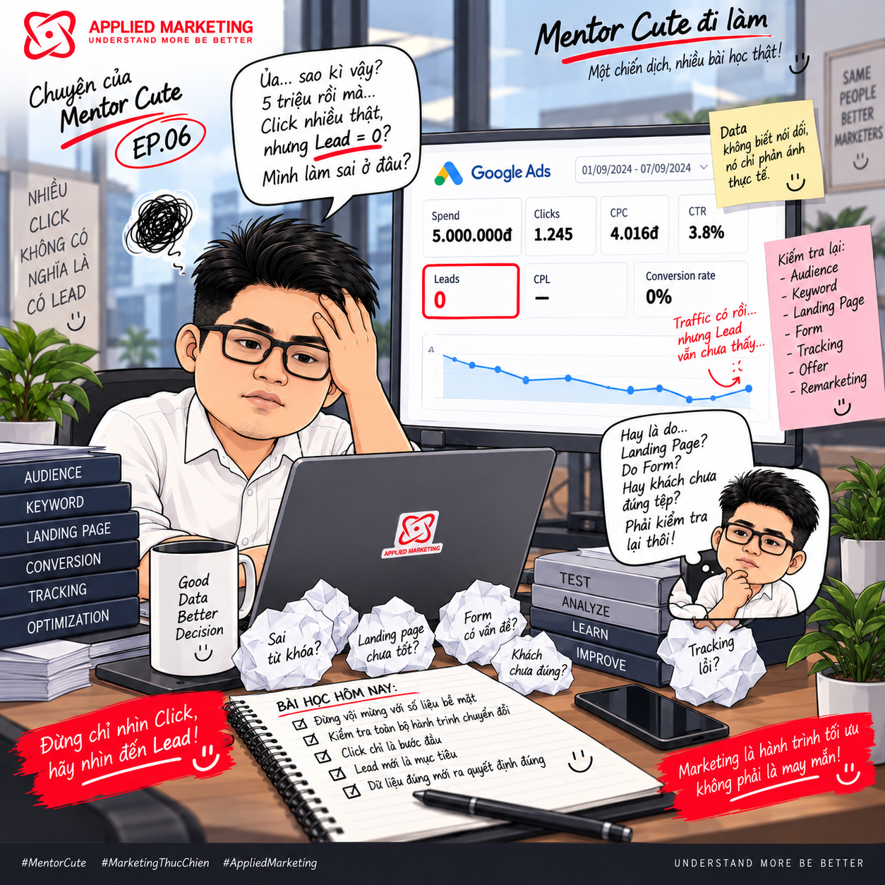

5 TRIỆU ĐÃ CHẠY, CLICK NHIỀU THẬT, NHƯNG LEAD = 0. SAI Ở ĐÂU? 😵  
  
Chuyện của Mentor Cute · EP.06  
  
“Ủa, sao kì vậy? 5 triệu rồi mà… click nhiều thật, nhưng khách để lại thông tin bằng 0?”  
  
Trong hình (số liệu giả định, chỉ mang tính tham khảo), chiến dịch chi 5.000.000đ, có 1.245 lượt bấm, tức khoảng 4.016đ mỗi lượt bấm, nhưng chưa có khách nào để lại thông tin.  
  
Vấn đề: nhiều lượt bấm không đồng nghĩa với có khách.  
  
Giữa cái bấm chuột và khách để lại thông tin còn một đoạn đường, và khách có thể rơi ra ở bất kỳ chỗ nào trên đoạn đó.  
  
Hệ quả: cứ thế bơm thêm tiền, bạn chỉ mua thêm những lượt bấm không dẫn đến đâu. Tệ hơn, bạn bắt đầu nghi ngờ cả chiến dịch lẫn chính mình.  
  
Giải pháp: đi ngược từ kết quả, kiểm tra từng điểm một.  
  
1. Nhóm khách: người bấm có đúng người mình cần không, hay chỉ bấm cho vui?  
2. Từ khóa: họ gõ gì để thấy quảng cáo? Từ quá rộng thường kéo cả những người chưa có nhu cầu.  
3. Trang đích (trang khách vào sau khi bấm): có khớp với lời hứa trong quảng cáo không? Mở bằng điện thoại có nhanh và dễ đọc không?  
4. Biểu mẫu: có quá nhiều ô phải điền không? Bấm gửi xong có thông báo thành công không?  
5. Theo dõi đo lường: người điền form có thật sự được ghi nhận không? Tự điền thử một lần xem số có nhảy không.  
6. Ưu đãi: khách được gì khi để lại thông tin? Lý do để điền đã đủ rõ chưa?  
7. Nhắc lại khách: có nhắc lại cho người đã vào trang nhưng chưa điền không?  
  
Nguyên tắc: sửa từng điểm một và ghi lại, để biết điểm nào mới thật sự có tác dụng.  
  
Steve Jobs khi trò chuyện với tạp chí The New York Times năm 2003 có một câu rất đáng nhớ về thiết kế: “It’s not just what it looks like and feels like. Design is how it works.” Đẹp mắt, dễ chịu mới là một nửa. Một trang đích hay cái form chỉ thật sự được tính là thiết kế tốt khi khách điền được trơn tru.  
  
Việc nên làm hôm nay: tự điền form của bạn bằng điện thoại, bấm giờ xem mất bao lâu và vướng ở đâu.  
  
Đừng chỉ nhìn vào click, hãy nhìn đến cả đoạn đường sau cú click. Theo bạn, điểm nào trong 7 điểm trên hay bị bỏ sót? Comment cho mình biết nha 👇  
  
---------------------------------  
💎 Applied Marketing – Mentor Xờ & Chạm Marketing  
📞 Hotline & Zalo: 033 955 7573  
🌐 Website: appliedmarketer.com  
#AppliedMarketing #MarketingThucChien #ContentMarketing #Content #DigitalMarketing #HocMarketing #Branding #BrandStrategy

---

## EP.07 · 19/11/2026 lúc 10:00 (bài 21)

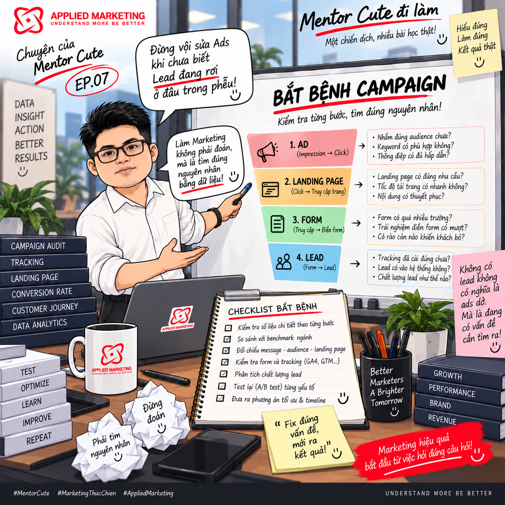

ĐỪNG VỘI SỬA ADS KHI CHƯA BIẾT LEAD ĐANG RƠI Ở ĐÂU TRONG PHỄU 🔍  
  
Chuyện của Mentor Cute · EP.07  
  
Khi khách để lại thông tin bằng 0, bạn làm gì đầu tiên?  
  
Phần lớn chúng ta phản xạ rất nhanh: sửa quảng cáo ngay. Mentor Cute chọn cách chậm hơn một chút, nhưng chắc hơn: đóng vai thám tử cho chiến dịch.  
  
Trong truyện A Scandal in Bohemia của Arthur Conan Doyle, thám tử Sherlock Holmes nói một câu mà dân làm số liệu nào cũng nên dán lên bàn: “It is a capital mistake to theorise before one has data.” Suy đoán khi chưa có dữ kiện là sai lầm lớn. Ông còn nói thêm: người ta thường bẻ sự việc cho vừa với giả thuyết, thay vì chỉnh giả thuyết cho vừa với sự việc. Nghe giống hệt cảnh chúng ta tin chắc “do hình quảng cáo dở” rồi đi sửa hình.  
  
1. Sửa nhiều thứ cùng lúc là cách rất nhanh để mất dấu nguyên nhân.  
  
Giống như uống cả đơn thuốc khi chưa biết mình bệnh gì: khỏi cũng không biết nhờ thuốc nào, nặng thêm cũng không biết vì thuốc nào.  
  
2. Hãy “khám” phễu khách hàng theo 4 chặng.  
  
Chặng quảng cáo (thấy rồi bấm): đúng nhóm khách chưa, thông điệp đủ hấp dẫn chưa? Nếu lượt bấm thấp so với lượt thấy, xem lại hình và câu chữ.  
Chặng trang đích (bấm rồi vào trang): nhiều người bấm nhưng vào xong thoát ngay thường là trang chưa khớp với quảng cáo, hoặc tải quá chậm.  
Chặng biểu mẫu (vào trang rồi điền form): form có quá nhiều ô không, điền có mượt không, có rào cản nào khiến khách bỏ ngang?  
Chặng ghi nhận (điền form rồi thành khách để lại thông tin): việc theo dõi đo lường đã cài đúng chưa, thông tin có về hệ thống không, chất lượng khách ra sao?  
  
3. Cách làm gọn: ghi số từng chặng ra giấy, tìm chặng tụt mạnh, chỉ sửa chặng đó, đo lại rồi mới sang chặng khác.  
  
Việc nên làm hôm nay: vẽ phễu 4 chặng cho chiến dịch của bạn và điền số vào từng chặng.  
  
Suy cho cùng, không có khách để lại thông tin chưa có nghĩa là quảng cáo dở. Nó chỉ cho biết đang có một chỗ cần được tìm ra.  
  
Lead của bạn hay rơi ở chặng nào? Comment cho mình biết nha 👇  
  
---------------------------------  
💎 Applied Marketing – Mentor Xờ & Chạm Marketing  
📞 Hotline & Zalo: 033 955 7573  
🌐 Website: appliedmarketer.com  
#AppliedMarketing #MarketingThucChien #ContentMarketing #Content #DigitalMarketing #HocMarketing #Branding #BrandStrategy

---

## EP.08 · 19/11/2026 lúc 20:00 (bài 22)

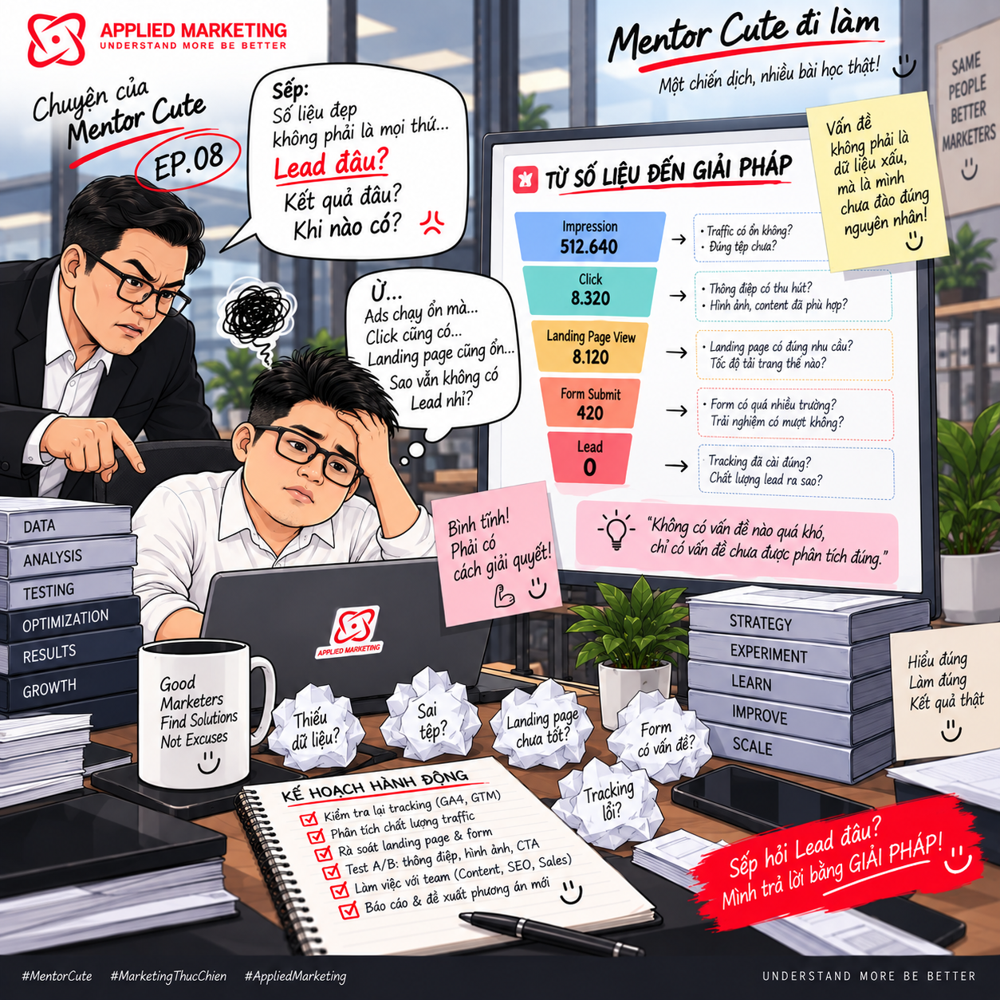

SẾP HỎI “LEAD ĐÂU?” THÌ MÌNH TRẢ LỜI BẰNG GIẢI PHÁP 💪  
  
Chuyện của Mentor Cute · EP.08  
  
Khi sếp hỏi “Lead đâu?”, trả lời “em đang tối ưu” có đủ không?  
  
Theo mình, chưa đủ. Sếp không cần nghe mình đang bận, sếp cần biết ba điều: chuyện gì đang xảy ra, bao giờ có kết quả, và mình làm gì tiếp.  
  
Sếp nhìn màn hình, nhíu mày: “Số liệu đẹp không phải là mọi thứ. Lead đâu? Kết quả đâu? Khi nào có?”. Mentor Cute hít sâu và mở phễu số liệu ra. (Số liệu trong hình là số giả định, chỉ mang tính tham khảo.)  
  
1. Đọc phễu trước khi trả lời.  
  
Phễu trong hình đi từ 512.640 lượt hiển thị, 8.320 lượt bấm, 8.120 lượt xem trang đích, 420 lượt gửi form, rồi khách để lại thông tin bằng 0. Có người gửi form mà không có khách nào được ghi nhận thì đây là lúc nghi ngờ việc theo dõi đo lường trước (đây là giả thuyết cần kiểm tra, chưa phải kết luận).  
  
2. Trả lời sếp bằng bản kế hoạch 6 dòng.  
  
Kiểm tra theo dõi đo lường: các “thẻ” trên trang (như Google Tag Manager, công cụ quản lý thẻ của Google, hay GA4 để xem lượt truy cập) có kích hoạt khi khách bấm gửi form không.  
Phân tích chất lượng lượt truy cập: khách đến từ đâu, ở lại bao lâu.  
Rà trang đích và form: tải nhanh chưa, form ngắn gọn chưa.  
Thử hai bản để so sánh (A/B test): mỗi lần đổi một thứ như tiêu đề, hình hoặc nút bấm, chạy song song rồi so kết quả.  
Thống nhất với các bên liên quan (nội dung, SEO, bán hàng) thế nào là một khách đạt yêu cầu.  
Báo cáo kèm mốc thời gian: hôm nay kiểm gì, ngày mai có kết quả gì, đề xuất gì.  
  
3. Vì sao cần kỷ luật số liệu như vậy?  
  
Có một câu hay được nhắc trong giới làm dữ liệu: “In God we trust, others must provide data.” Đại ý: với Chúa thì ta tin, còn lại ai nói gì cũng hãy mang số liệu ra. Câu này lâu nay hay được gán cho W. Edwards Deming, nhưng bản xuất hiện sớm nhất mà người ta tìm được là một lời điều trần trước Quốc hội Mỹ năm 1978, nên mình chỉ coi đây là một câu nói lưu truyền. Dù của ai, tinh thần thì rất đúng với cuộc họp lúc sếp hỏi “Lead đâu?”.  
  
Việc nên làm hôm nay: chuẩn bị sẵn một tờ “kế hoạch 6 dòng” để mỗi lần sếp hỏi kết quả, bạn có ngay câu trả lời.  
  
Không có vấn đề nào quá khó, chỉ có vấn đề chưa được phân tích đúng chỗ.  
  
Khi sếp hỏi “Lead đâu?”, bạn thường trả lời thế nào? Chia sẻ cho mình nghe nha 👇  
  
---------------------------------  
💎 Applied Marketing – Mentor Xờ & Chạm Marketing  
📞 Hotline & Zalo: 033 955 7573  
🌐 Website: appliedmarketer.com  
#AppliedMarketing #MarketingThucChien #ContentMarketing #Content #DigitalMarketing #HocMarketing #Branding #BrandStrategy

---

## EP.09 · 20/11/2026 lúc 10:00 (bài 23)

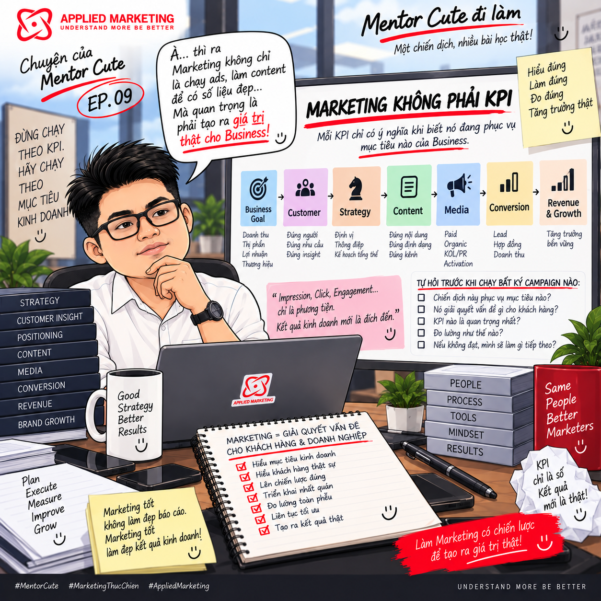

MARKETING KHÔNG PHẢI LÀ KPI: HÃY CHẠY THEO MỤC TIÊU KINH DOANH 🎯  
  
Chuyện của Mentor Cute · EP.09  
  
Marketing giỏi là marketing có báo cáo đẹp, hay marketing giúp doanh nghiệp lớn lên?  
  
Một câu hỏi mà mình thấy nhiều bạn trẻ trong nghề băn khoăn, nhất là sau vài tháng chạy theo chỉ tiêu.  
  
Theo mình, câu trả lời là vế sau. Nhưng điều quan trọng là mình phải biết nối từng con số về đúng mục tiêu của doanh nghiệp.  
  
Mentor Cute thốt lên: “À… thì ra Marketing không chỉ là chạy quảng cáo, làm nội dung để có số liệu đẹp. Quan trọng là phải tạo ra giá trị thật cho doanh nghiệp!”  
  
1. KPI (chỉ tiêu đo kết quả) rất cần, nhưng chỉ là phương tiện.  
  
Lượt xem, lượt bấm, lượt tương tác giúp mình biết mình đang đi thế nào. Còn đích đến là doanh thu, lợi nhuận, khách quay lại. Khi quên điều này, cả đội dễ bận rộn giỏi mà chẳng ai trả lời được “làm để làm gì”.  
  
2. Cách nối chỉ tiêu với mục tiêu: đi từ phải sang trái.  
  
Mentor vẽ lên bảng một chuỗi: Mục tiêu kinh doanh, Khách hàng, Chiến lược, Nội dung, Kênh, Chuyển đổi (khách làm điều mình mong), Doanh thu và tăng trưởng.  
Bắt đầu từ mục tiêu của doanh nghiệp. Ví dụ giả định: tăng số đơn của một dòng sản phẩm.  
Hỏi: muốn thêm đơn thì khách phải làm gì? Nhắn tin, đặt hàng hay quay lại mua lần hai?  
Từ hành động đó chọn chỉ tiêu theo dõi, rồi mới đến nội dung và kênh.  
Đặt chỉ tiêu bề mặt như lượt xem, tương tác ở vai phụ: để chẩn đoán, không phải để tự khen.  
  
3. Năm câu tự hỏi trước mỗi chiến dịch.  
  
Chiến dịch này phục vụ mục tiêu nào? Nó giải quyết vấn đề gì cho khách? Chỉ tiêu nào quan trọng với mục tiêu này? Đo bằng cách nào? Nếu không đạt, mình làm gì tiếp theo?  
  
Từ năm 1954, trong cuốn The Practice of Management, Peter Drucker đã viết một câu ngắn mà đến nay vẫn đúng: “There is only one valid definition of business purpose: to create a customer.” Mục đích của doanh nghiệp chỉ có một: tạo ra khách hàng. Marketing làm đúng thì mọi con số đều quay về điểm này.  
  
Việc nên làm hôm nay: lưu 5 câu hỏi trên và trả lời trước khi bắt đầu chiến dịch kế tiếp.  
  
Marketing tốt không làm đẹp báo cáo, mà làm đẹp kết quả kinh doanh. Câu nào trong 5 câu bạn hay quên hỏi? Comment cho mình biết 👇  
  
---------------------------------  
💎 Applied Marketing – Mentor Xờ & Chạm Marketing  
📞 Hotline & Zalo: 033 955 7573  
🌐 Website: appliedmarketer.com  
#AppliedMarketing #MarketingThucChien #ContentMarketing #Content #DigitalMarketing #HocMarketing #Branding #BrandStrategy

---

## EP.10 · 20/11/2026 lúc 20:00 (bài 24)

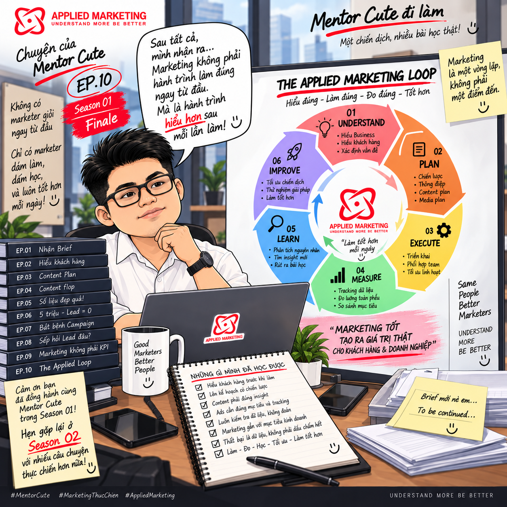

SEASON 1 FINALE: MARKETING LÀ HÀNH TRÌNH HIỂU HƠN SAU MỖI LẦN LÀM 🔄  
  
Chuyện của Mentor Cute · EP.10  
  
“Sau tất cả, mình nhận ra… Marketing không phải hành trình làm đúng ngay từ đầu, mà là hành trình hiểu hơn sau mỗi lần làm.”  
  
Trước (Before): 10 tập của Season 1, Mentor Cute từ chỗ nhận brief ngợp đầu, đến những cú vấp như bài không ai xem, số đẹp mà không có khách để lại thông tin, rồi bị sếp hỏi “Lead đâu?”. Mỗi lần vấp là một lần tự hỏi mình có hợp nghề này không.  
  
Sau (After): vẫn là Mentor Cute đó, nhưng biết hỏi trước khi làm, biết nhìn số theo từng chặng, và biết rằng sai không đáng sợ nếu mình ghi lại được vì sao.  
  
Cầu nối (Bridge): một vòng lặp học hỏi sau mỗi chiến dịch. Nhiều người làm xong là chuyển ngay sang việc khác, không ngồi lại xem điều gì đã xảy ra. Kết quả: sai lầm cũ lặp lại, mà thành công cũng không biết nhờ đâu.  
  
Vòng lặp 6 bước của Applied Marketing:  
01 Hiểu: hiểu doanh nghiệp, hiểu khách hàng, xác định đúng vấn đề.  
02 Lập kế hoạch: chiến lược, thông điệp, nội dung, kênh.  
03 Triển khai: làm, phối hợp với đội, chỉnh linh hoạt.  
04 Đo lường: theo dõi dữ liệu từng chặng và đối chiếu mục tiêu.  
05 Rút kinh nghiệm: phân tích nguyên nhân, ghi lại bài học.  
06 Cải thiện: thử giải pháp mới, làm tốt hơn lần sau.  
  
Một mẹo nhỏ: sau mỗi chiến dịch, họp 20 phút với ba câu hỏi. Điều gì chạy tốt? Điều gì chưa tốt? Lần sau mình đổi gì? Ghi vào một tệp chung để cả đội đọc lại.  
  
Năm 2005, đứng trước sinh viên tốt nghiệp Đại học Stanford, Steve Jobs kể rằng ông chỉ thấy các chấm nối được với nhau khi ngoái nhìn lại: “You can’t connect the dots looking forward; you can only connect them looking backward.” Đi tới thì mờ, nhìn lại mới thấy đường. Mỗi lần ngồi lại sau chiến dịch chính là lúc bạn nối những chấm ấy.  
  
Việc nên làm hôm nay: chọn một chiến dịch vừa kết thúc và viết ra 3 dòng bài học.  
  
Cảm ơn bạn đã đồng hành cùng Mentor Cute trong Season 1! Hẹn gặp lại ở Season 2. Tập nào làm bạn thấy giống mình? Comment cho mình biết nha 👇  
  
---------------------------------  
💎 Applied Marketing – Mentor Xờ & Chạm Marketing  
📞 Hotline & Zalo: 033 955 7573  
🌐 Website: appliedmarketer.com  
#AppliedMarketing #MarketingThucChien #ContentMarketing #Content #DigitalMarketing #HocMarketing #Branding #BrandStrategy

---

## EP.11 · 21/11/2026 lúc 10:00 (bài 25)

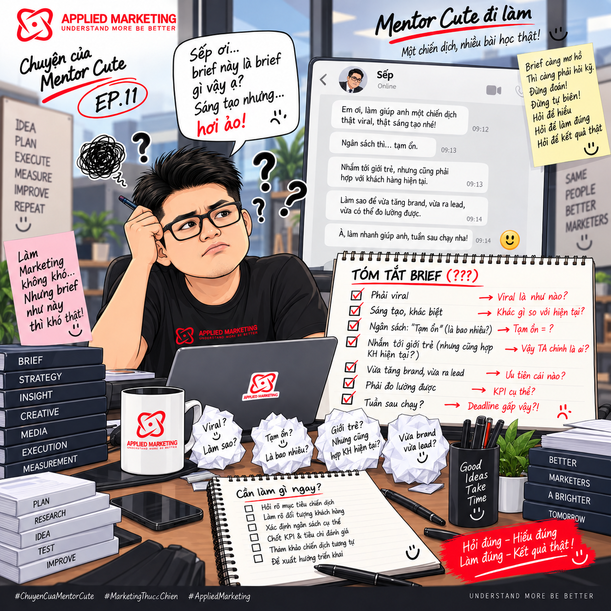

BRIEF “VIRAL, SÁNG TẠO, NGÂN SÁCH TẠM ỔN, TUẦN SAU CHẠY” THÌ PHẢI HỎI LẠI GÌ? 🤔  
  
Chuyện của Mentor Cute · EP.11 (Season 2)  
  
Chú ý: tin nhắn của sếp đến lúc 9h12. Làm giúp một chiến dịch thật lan truyền, thật sáng tạo; ngân sách thì “tạm ổn”; nhắm tới giới trẻ nhưng cũng phải hợp khách hiện tại; vừa tăng độ nhận biết, vừa có khách để lại thông tin, vừa đo lường được; à, tuần sau chạy nha! Mentor Cute chỉ biết gãi đầu: brief này là brief gì vậy ạ?  
  
Quan tâm: brief mơ hồ giống tấm bản đồ không có điểm đến.  
  
Nếu làm theo cách hiểu của riêng mình, bản làm ra có thể đẹp mà sếp lại nghĩ khác. Hậu quả là sửa đi sửa lại, tốn thời gian của cả hai bên. Điều đáng nói là không phải sếp cố ý khó, mà vì đa số người giao việc thường chưa có thời gian nghĩ kỹ điều mình cần.  
  
Mong muốn: có một cách hỏi lại vừa lịch sự vừa gọn, để sếp không thấy bị chất vấn.  
  
Mẹo là đừng hỏi “ý anh là gì ạ?”, hãy đưa ra một câu hỏi kèm lựa chọn cho từng chỗ mơ hồ:  
  
1. “Lan truyền mạnh”: đo bằng gì, lượt chia sẻ, lượt xem hay lượt nhắn tin? Con số nào thì anh thấy là được?  
2. “Ngân sách tạm ổn”: anh cho em một khoảng, từ đâu đến đâu, được không ạ?  
3. “Giới trẻ nhưng hợp khách hiện tại”: nếu hai nhóm khác nhau thì mình ưu tiên nhóm nào làm chính?  
4. “Vừa nhận biết, vừa ra khách”: mục tiêu nào trước, mục tiêu nào phụ?  
5. “Tuần sau chạy”: ngày giờ cụ thể là khi nào, ai duyệt, duyệt tối đa mấy vòng?  
  
Rồi gửi lại sếp bản tóm tắt 5 dòng gồm mục tiêu chính, nhóm khách, ngân sách, chỉ tiêu, ngày chạy. Sếp chỉ cần trả lời “đúng” hoặc sửa một chỗ.  
  
Trong giới quảng cáo lâu nay có một câu hay được nhắc: người ta không thật sự muốn mua mũi khoan, họ muốn có cái lỗ trên tường. “People don’t want to buy a quarter-inch drill. They want a quarter-inch hole.” Câu này thường gắn với Leo McGivena và được Theodore Levitt, giáo sư Harvard, đưa vào bài giảng marketing từ cuối thập niên 1960. “Viral”, “nhiều lead” chỉ là cái khoan. Cái lỗ mà sếp cần có thể là doanh thu, khách quay lại hay một thương hiệu được nhớ. Hỏi ra được cái lỗ ấy là xong nửa việc.  
  
Hành động: lần tới nhận brief, hãy dành 15 phút để gửi lại bản tóm tắt 5 dòng trước khi làm bất cứ điều gì.  
  
Một chiến dịch tốt bắt đầu bằng một câu hỏi tốt. Bạn từng nhận brief mơ hồ đến mức nào? Kể mình nghe với nha 👇  
  
---------------------------------  
💎 Applied Marketing – Mentor Xờ & Chạm Marketing  
📞 Hotline & Zalo: 033 955 7573  
🌐 Website: appliedmarketer.com  
#AppliedMarketing #MarketingThucChien #ContentMarketing #Content #DigitalMarketing #HocMarketing #Branding #BrandStrategy

---

## EP.12 · 21/11/2026 lúc 20:00 (bài 26)

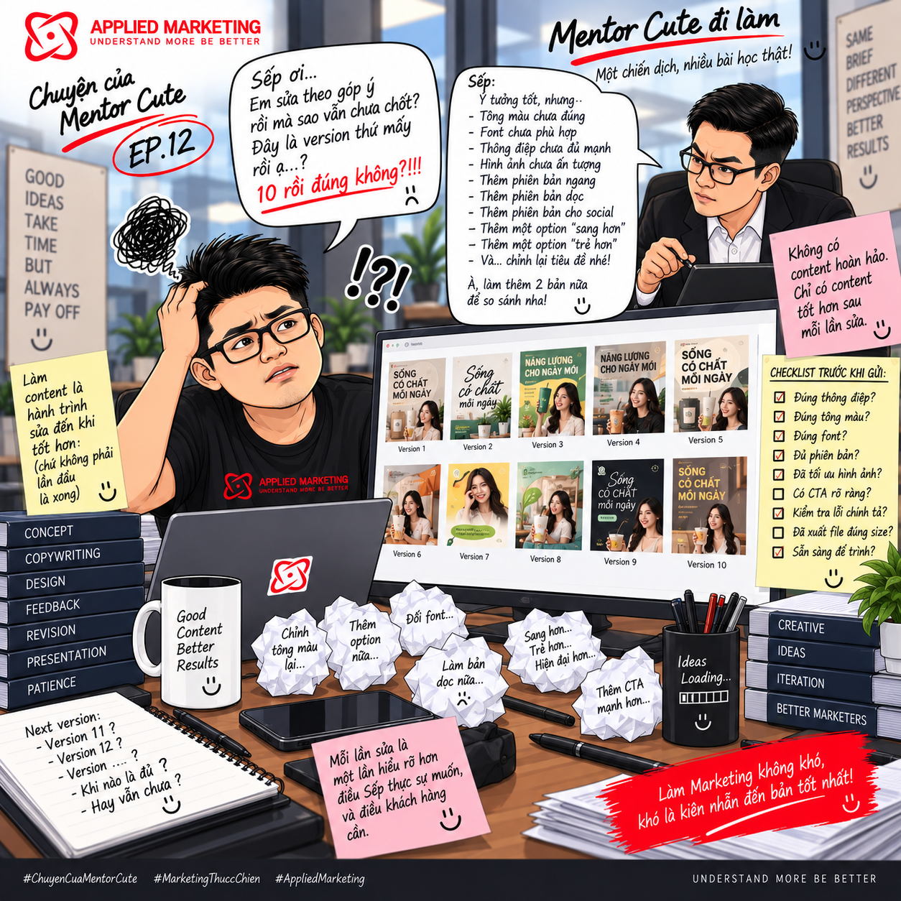

SỬA ĐẾN VERSION 10 RỒI MÀ SẾP VẪN CHƯA CHỐT: LÀM SAO ĐÂY? 🎨  
  
Chuyện của Mentor Cute · EP.12  
  
“Sếp ơi, em sửa theo góp ý rồi mà sao vẫn chưa chốt? Đây là version thứ mấy rồi ạ…?”  
  
Màn hình hiện dãy phiên bản thiết kế. Sếp nhắn: ý tưởng tốt nhưng tông màu chưa đúng, font chưa phù hợp, thông điệp chưa đủ mạnh, thêm bản ngang, bản dọc, bản cho mạng xã hội, thêm lựa chọn “sang hơn”, “trẻ hơn”, và làm thêm 2 bản nữa để so sánh nha! Mentor Cute chỉ biết nhìn đống giấy nhăn dưới bàn. 😅  
  
Vấn đề: không phải bản làm chưa đủ tốt, mà là chưa ai nói rõ thế nào là “xong”.  
  
Khi tiêu chí còn nằm trong đầu mỗi người, bản nào cũng có thể bị sửa tiếp.  
  
Hệ quả: mỗi vòng sửa tốn thêm thời gian, đội mất động lực, còn sếp thì ngày càng không chắc mình đang muốn gì. Cả hai bên đều mệt mà chưa ai thấy đích.  
  
Giải pháp: chốt tiêu chí trước, giới hạn vòng sửa.  
  
1. Trước khi thiết kế, viết ra 3 tiêu chí để duyệt rồi nhờ sếp đồng ý. Ví dụ giả định: đúng thông điệp chính, đọc rõ trên điện thoại, đúng màu thương hiệu.  
2. Khi nhận góp ý, hỏi lại nhẹ nhàng: “Góp ý này giúp mình đạt tiêu chí nào ạ?”. Góp ý nào không thuộc tiêu chí nào thì ghi vào mục “để lần sau”.  
3. Gom góp ý vào một chỗ và trả lời một lần, đừng sửa theo từng tin nhắn lẻ.  
4. Thống nhất số vòng sửa. Ví dụ giả định: tối đa hai vòng, sau đó chỉ sửa lỗi, không đổi hướng.  
5. Gửi 2 đến 3 phương án có lý do rõ ràng, thay vì mười bản gần giống nhau.  
  
Danh sách kiểm tra trước khi gửi: đúng thông điệp, đúng tông màu, đúng font, đủ phiên bản, đã tối ưu hình ảnh, lời kêu gọi hành động (CTA) đã rõ, đã xuất file đúng kích thước.  
  
Peter Drucker từng viết trên tạp chí Harvard Business Review năm 1963 một câu nghe vừa buồn cười vừa đau: “There is surely nothing quite so useless as doing with great efficiency what should not be done at all.” Không có gì vô ích bằng việc làm thật nhanh, thật giỏi một việc vốn không nên làm. Mười phiên bản sửa mà không chung một đích cũng là cách làm giỏi sai việc.  
  
Việc nên làm hôm nay: cho dự án kế tiếp, viết 3 tiêu chí duyệt và gửi sếp trước khi bắt đầu.  
  
Không có nội dung hoàn hảo, chỉ có nội dung tốt hơn sau mỗi lần sửa. Nhưng sửa có đích thì ngắn hơn rất nhiều. Bạn có mẹo nào để chốt bản nhanh? Chia sẻ ở bình luận nha 👇  
  
---------------------------------  
💎 Applied Marketing – Mentor Xờ & Chạm Marketing  
📞 Hotline & Zalo: 033 955 7573  
🌐 Website: appliedmarketer.com  
#AppliedMarketing #MarketingThucChien #ContentMarketing #Content #DigitalMarketing #HocMarketing #Branding #BrandStrategy

---

## EP.13 · 22/11/2026 lúc 10:00 (bài 27)

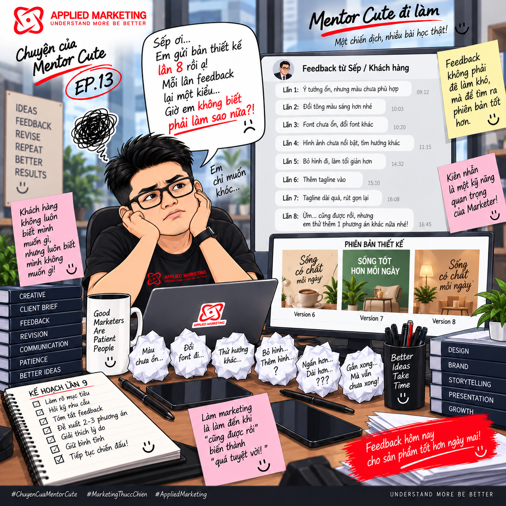

FEEDBACK LẦN 8: “EM CHỈ MUỐN KHÓC…” NHƯNG ĐỪNG BỎ CUỘC! 😭  
  
Chuyện của Mentor Cute · EP.13  
  
“Sếp ơi, em gửi bản thiết kế lần 8 rồi ạ! Mỗi lần góp ý lại một kiểu… Giờ em không biết phải làm sao nữa?!”  
  
Mentor Cute mở khung chat: lần 1 màu chưa phù hợp, lần 2 đổi tông sáng hơn, lần 3 đổi font, lần 4 tìm hướng hình khác, lần 5 bỏ hình cho tối giản, lần 6 thêm câu khẩu hiệu, lần 7 khẩu hiệu dài quá, lần 8 “cũng được rồi, nhưng thử thêm một phương án nữa nhé!”. 🙃  
  
Cảm thấy (Feel): nếu bạn đang mệt và muốn khóc, mình hiểu. Nhận tám vòng góp ý trái chiều dễ làm người ta nghĩ mình làm chưa đủ giỏi.  
  
Từng cảm thấy (Felt): rất nhiều người làm nghề này từng thấy y như vậy. Thường điều làm ta mệt không phải là sửa, mà là cảm giác đang chạy theo một mục tiêu cứ dịch chuyển.  
  
Tìm ra (Found): người góp ý thường nói được điều họ không thích trước khi biết điều họ muốn. Nếu mình chỉ đáp lại từng câu, mình sẽ đi vòng quanh cùng họ. Cần đổi vai: từ người sửa theo thành người cùng tìm hướng.  
  
Cách làm, “kế hoạch lần 9” của Mentor:  
1. Làm rõ mục tiêu: bản này dùng để làm gì, ai xem, xem ở đâu?  
2. Xin ví dụ thay vì tính từ. “Anh thích mẫu nào đã thấy rồi ạ?” giúp hiểu nhanh hơn nhiều so với “sang hơn”, “trẻ hơn”.  
3. Tóm tắt toàn bộ góp ý 8 lần thành 3 đến 4 ý chính, rồi hỏi sếp xác nhận.  
4. Đề xuất 2 đến 3 phương án thật sự khác nhau, mỗi phương án có một dòng lý do vì sao hợp mục tiêu.  
5. Tách chuyện “bản thiết kế” khỏi chuyện “bản thân mình”. Góp ý là về sản phẩm, không phải đánh giá con người bạn.  
6. Ghi lại những gì đã chốt để không phải bàn lại từ đầu.  
  
Về chuyện vì sao đưa phương án lại nhanh hơn hỏi, Steve Jobs từng chia sẻ với tạp chí BusinessWeek năm 1998: “It’s really hard to design products by focus groups. A lot of times, people don’t know what they want until you show it to them.” Nghĩa là nhiều khi người ta chỉ biết mình muốn gì khi nhìn thấy nó trước mắt. Cho nên thay vì hỏi “anh muốn gì”, hãy đặt vài lựa chọn lên bàn rồi nhìn phản ứng.  
  
Việc nên làm hôm nay: lần tới nhận góp ý mơ hồ, xin thêm hai ví dụ tham khảo và gửi lại 2 đến 3 phương án.  
  
Phản hồi không sinh ra để làm khó mình, mà để cùng tìm ra bản tốt hơn. Bạn đã qua bao nhiêu vòng góp ý cho một sản phẩm? Comment cho mình biết nha 👇  
  
---------------------------------  
💎 Applied Marketing – Mentor Xờ & Chạm Marketing  
📞 Hotline & Zalo: 033 955 7573  
🌐 Website: appliedmarketer.com  
#AppliedMarketing #MarketingThucChien #ContentMarketing #Content #DigitalMarketing #HocMarketing #Branding #BrandStrategy

---

## EP.14 · 22/11/2026 lúc 20:00 (bài 28)

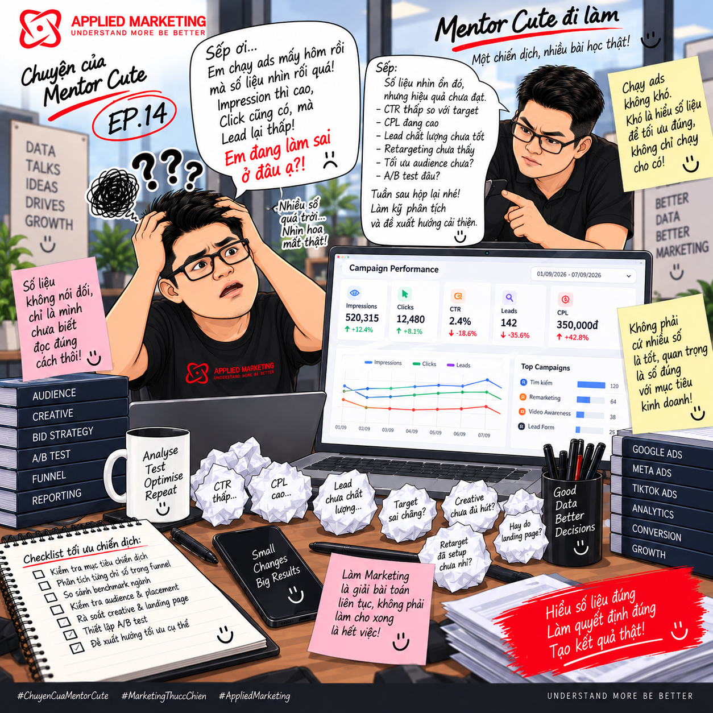

IMPRESSION CAO, CLICK CÓ, LEAD THẤP: EM ĐANG LÀM SAI Ở ĐÂU? 📊  
  
Chuyện của Mentor Cute · EP.14  
  
Tình huống: “Sếp ơi, em chạy quảng cáo mấy hôm rồi mà số liệu nhìn rối quá! Lượt hiển thị thì cao, lượt bấm cũng có, mà khách để lại thông tin lại thấp!”  
  
Bảng số trong hình (số liệu giả định, chỉ mang tính tham khảo) cho thấy hơn 520 nghìn lượt hiển thị, 12.480 lượt bấm, tỉ lệ bấm (CTR) 2,4%, 142 khách để lại thông tin, chi phí mỗi khách (CPL) 350.000đ. Sếp nhận xét: tỉ lệ bấm thấp so với mục tiêu, chi phí mỗi khách đang cao, chất lượng khách chưa tốt, chưa thấy nhắc lại người từng xem, nhóm khách đã tối ưu chưa, thử hai bản đâu?  
  
Điểm rối: nhiều số liệu nhưng không có thứ tự ưu tiên thì rất dễ rối. Đáng sợ hơn là sửa tất cả cùng lúc, rồi không biết cái gì có tác dụng.  
  
Câu hỏi: vậy nên bắt đầu từ đâu?  
  
Trả lời: tối ưu theo thứ tự, mỗi lần một thứ.  
  
1. Chốt mục tiêu chiến dịch và chỉ tiêu chính. Ví dụ giả định: chi phí mỗi khách đạt mức mong muốn.  
2. Đi dọc phễu: so từng chặng, tìm chặng tụt mạnh.  
3. So với mức tham chiếu của ngành hoặc, tốt hơn, của chính các chiến dịch cũ của bạn. Mốc của chính mình thường đáng tin hơn con số chung chung.  
4. Kiểm tra nhóm khách và vị trí hiển thị quảng cáo: có đang tới đúng người không?  
5. Rà hình, câu chữ quảng cáo và trang đích: thông điệp có khớp nhau từ đầu đến cuối không?  
6. Thử hai bản (A/B test) với một thay đổi mỗi lần và ghi lại kết quả.  
7. Đề xuất hướng cụ thể: làm gì, đo gì, khi nào xem lại.  
  
Về chuyện thử nghiệm, người ta kể rằng Jeff Bezos từng nói: “If you double the number of experiments you do per year you’re going to double your inventiveness.” Nhân đôi số thử nghiệm mỗi năm thì khả năng sáng tạo cũng nhân đôi theo. (Câu này được trích lại trong sách The Amazon Way on IoT của John Rossman, mình chưa tìm được hoàn cảnh gốc nên chỉ chia sẻ như một lời kể.) Điều đáng giữ lại là thử nhiều thì được, miễn mỗi lần chỉ đổi một thứ và ghi lại.  
  
Việc nên làm hôm nay: chọn một thử nghiệm nhỏ cho tuần này, ví dụ đổi tiêu đề quảng cáo, và ghi kết quả vào bảng.  
  
Số liệu không nói dối, chỉ là mình chưa biết đọc đúng thứ tự. Khi nhìn báo cáo, bạn đọc từ chỉ số nào trước? Chia sẻ cho mình nghe nha 👇  
  
---------------------------------  
💎 Applied Marketing – Mentor Xờ & Chạm Marketing  
📞 Hotline & Zalo: 033 955 7573  
🌐 Website: appliedmarketer.com  
#AppliedMarketing #MarketingThucChien #ContentMarketing #Content #DigitalMarketing #HocMarketing #Branding #BrandStrategy

---

## EP.15 · 23/11/2026 lúc 10:00 (bài 29)

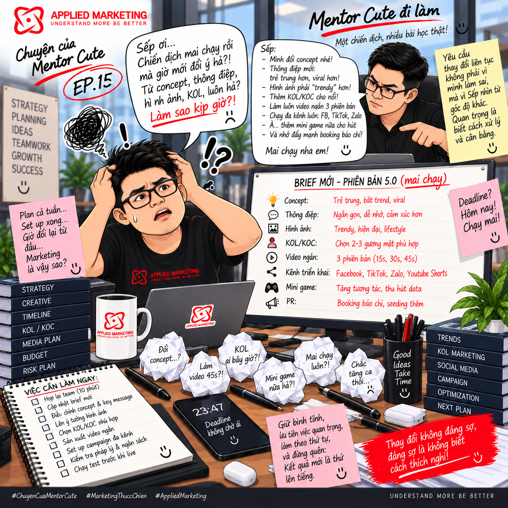

CHIẾN DỊCH MAI CHẠY MÀ HÔM NAY SẾP ĐỔI Ý: LÀM SAO KỊP GIỜ? ⏰  
  
Chuyện của Mentor Cute · EP.15  
  
Chiến dịch mai chạy mà tối nay sếp đổi hướng: nhận hay từ chối?  
  
Theo mình, cả hai đều không phải là câu trả lời hay. Điều bạn cần là một cách chia việc theo mức bắt buộc.  
  
23h47, hạn chót không chờ ai. “Sếp ơi, chiến dịch mai chạy rồi mà giờ mới đổi ý hả?! Từ ý tưởng, thông điệp, hình ảnh, KOL luôn hả? Làm sao kịp giờ?!”  
  
Bản yêu cầu mới “phiên bản 5.0” hiện lên bảng: ý tưởng trẻ trung bắt xu hướng, thông điệp ngắn dễ nhớ, hình ảnh hiện đại, 2 đến 3 gương mặt có sức ảnh hưởng, video ngắn 3 phiên bản (15, 30 và 45 giây), triển khai Facebook, TikTok, Zalo, YouTube Shorts, thêm minigame và báo chí. Mentor Cute chỉ biết ôm đầu. 😰  
  
1. Nếu cố làm hết, làm gì cũng dở. Nếu từ chối hết, mất lòng và có thể mất cả niềm tin.  
  
Con đường giữa là phân loại: việc nào là cốt lõi, việc nào làm thêm nếu kịp.  
  
2. Hít thở, họp nhanh 10 phút, rồi hỏi sếp đúng một câu.  
  
“Trong bản mới, mục tiêu cốt lõi không đổi là gì ạ? Phần nào bắt buộc, phần nào nếu kịp?” Câu hỏi này giúp sếp tự nhìn lại, và thường thì danh sách “bắt buộc” ngắn hơn nhiều so với lúc nhắn.  
  
3. Sắp việc theo thứ tự rồi báo rủi ro.  
  
Thông điệp chính và ý tưởng làm trước, rồi đến hình ảnh, cuối cùng mới là phần phụ như minigame.  
Nói rõ việc gì làm được trong đêm nay, việc gì cần thêm thời gian, và đề xuất chia giai đoạn. Ví dụ giả định: chạy một kênh trước, thêm kênh sau.  
Kiểm tra nhanh các điểm dễ sai khi gấp: pháp lý, ngân sách, hình ảnh có bản quyền.  
Nếu còn thời gian, chạy thử ở quy mô nhỏ trước khi chạy thật.  
  
Jeff Bezos, trong buổi họp cổ đông Amazon năm 2011, đã nói một câu mà đội nào hay gặp thay đổi phút chót đều nên nhớ: “We are stubborn on vision. We are flexible on details.” Mình bướng với tầm nhìn, nhưng mềm với chi tiết. Với chiến dịch, đó là giữ cho được mục tiêu cốt lõi và linh hoạt ở tất cả phần còn lại.  
  
Việc nên làm hôm nay: chuẩn bị sẵn một “danh sách bắt buộc và nếu kịp” để dùng khi gặp thay đổi phút chót.  
  
Thay đổi không đáng sợ, đáng sợ là không biết cách thích nghi. Bạn từng gặp tình huống “mai chạy mà hôm nay đổi brief” chưa? Kể mình nghe nha 👇  
  
---------------------------------  
💎 Applied Marketing – Mentor Xờ & Chạm Marketing  
📞 Hotline & Zalo: 033 955 7573  
🌐 Website: appliedmarketer.com  
#AppliedMarketing #MarketingThucChien #ContentMarketing #Content #DigitalMarketing #HocMarketing #Branding #BrandStrategy

---

## EP.16 · 23/11/2026 lúc 20:00 (bài 30)

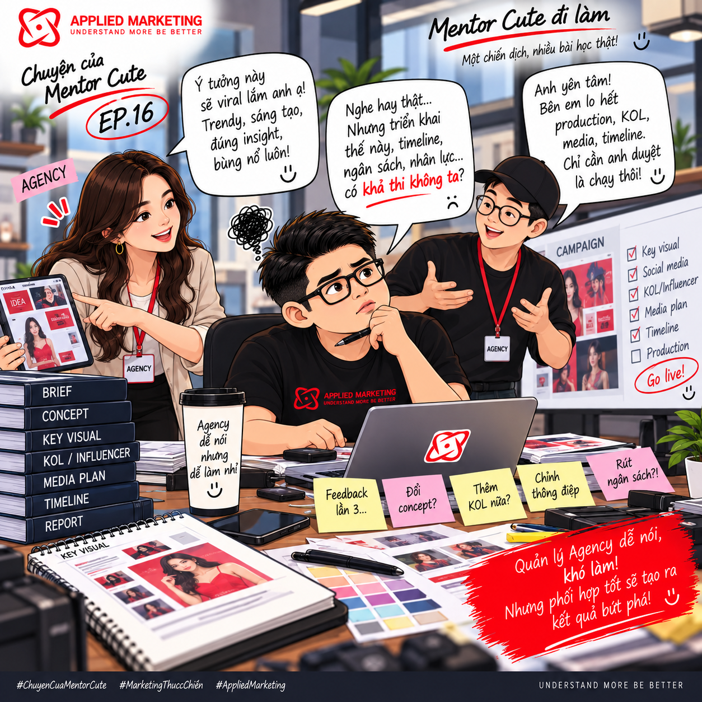

QUẢN LÝ AGENCY: DỄ NÓI, KHÓ LÀM! 🤝  
  
Chuyện của Mentor Cute · EP.16  
  
Giao việc cho agency (công ty làm truyền thông thuê ngoài) rồi, bên đặt hàng có thể thở phào chưa?  
  
Theo mình, chưa. Giao việc chỉ là bắt đầu, còn phần phối hợp mới quyết định kết quả.  
  
Bạn agency hào hứng: “Ý tưởng này sẽ viral lắm anh ạ! Trendy, sáng tạo, đúng insight, bùng nổ luôn!”. Bạn còn lại cười tươi: “Anh yên tâm, bên em lo hết sản xuất, KOL, kênh truyền thông, tiến độ. Anh chỉ cần duyệt là chạy thôi!”. Mentor Cute nghe rất hay, nhưng trong đầu vẫn lởn vởn: tiến độ, ngân sách, nhân lực có khả thi không ta? Trên bàn còn mấy tờ ghi chú: Feedback lần 3, Đổi ý tưởng?, Thêm KOL nữa?, Rút ngân sách?! 😅  
  
1. Điều dễ tin: lời hứa “sẽ viral” là chắc chắn.  
  
Sự thật: không ai bảo đảm trước được một nội dung sẽ lan truyền. Một đối tác tốt nói về cách làm, mốc thời gian và cách đo, không hứa kết quả chắc chắn.  
  
2. Điều dễ tin: mỗi bên hiểu “xong” giống nhau.  
  
Sự thật: bên đặt hàng hiểu “xong” là đạt mục tiêu, agency hiểu “xong” có thể là giao đủ sản phẩm. Khác định nghĩa thì sinh tranh cãi, và rủi ro thường rơi về bên đặt hàng.  
  
3. Cách làm: 6 thỏa thuận nên có trước khi bắt đầu.  
  
Brief và phạm vi: ghi rõ việc nào thuộc agency, việc nào thuộc mình.  
Mục tiêu và cách đo: thống nhất chỉ tiêu trước khi chạy, không đợi chạy xong mới bàn.  
Tiến độ chia mốc: mỗi mốc có sản phẩm cụ thể và ngày giao.  
Tính khả thi: hỏi thẳng về thời gian, ngân sách, nhân lực; xin kế hoạch dự phòng khi có thay đổi.  
Số vòng góp ý và người có quyền duyệt cuối: tránh mỗi người một ý.  
Báo cáo định kỳ: báo thế nào, bao lâu một lần, số liệu nào.  
  
David Ogilvy, người sáng lập hãng quảng cáo Ogilvy, được cho là từng nhắn nhủ các cộng sự một ý rất đẹp: nếu ai trong chúng ta cũng chọn người giỏi hơn mình, chúng ta sẽ trở thành một công ty của những người khổng lồ. “If each of us hires people who are bigger than we are, we shall become a company of giants.” (Đây là lời kể lại qua Ogilvy on Advertising, mình chưa đối chiếu được nguyên văn.) Chọn đối tác giỏi rồi nói rõ đích đến cho họ mới là cách hợp tác lâu dài.  
  
Việc nên làm hôm nay: viết 6 dòng thỏa thuận trên và gửi agency trước buổi làm việc đầu tiên.  
  
Quản lý agency nghe thì dễ, nhưng phối hợp tốt sẽ tạo ra kết quả vượt mong đợi. Bạn đã làm việc với agency bao giờ chưa? Chia sẻ trải nghiệm nha 👇  
  
---------------------------------  
💎 Applied Marketing – Mentor Xờ & Chạm Marketing  
📞 Hotline & Zalo: 033 955 7573  
🌐 Website: appliedmarketer.com  
#AppliedMarketing #MarketingThucChien #ContentMarketing #Content #DigitalMarketing #HocMarketing #Branding #BrandStrategy

---

## EP.17 · 24/11/2026 lúc 10:00 (bài 31)

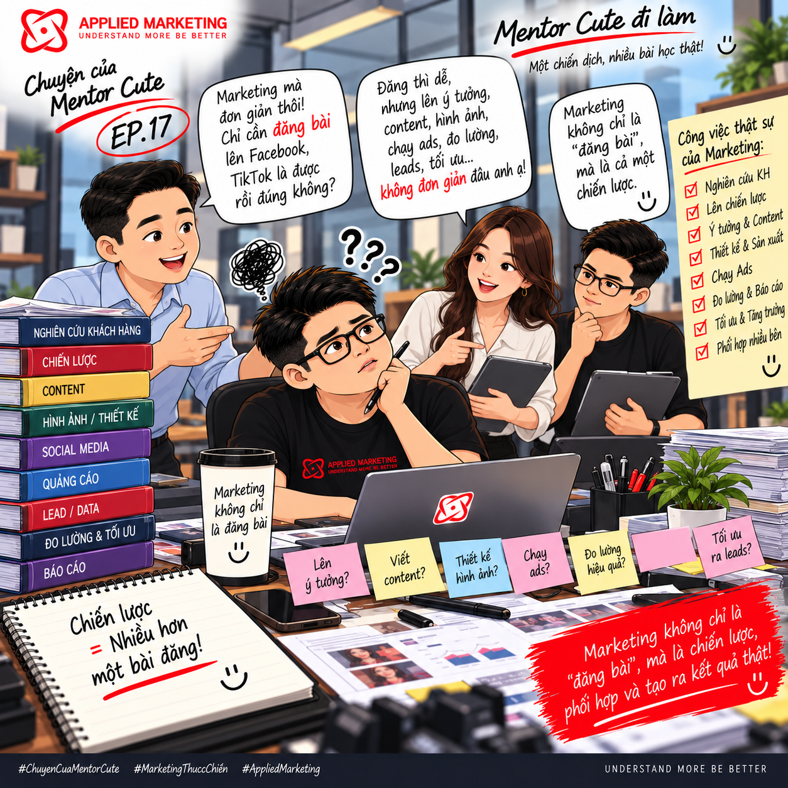

MARKETING MÀ ĐƠN GIẢN THÔI, CHỈ CẦN ĐĂNG BÀI LÊN FACEBOOK, TIKTOK LÀ ĐƯỢC? 😅  
  
Chuyện của Mentor Cute · EP.17  
  
Chú ý: một bạn đồng nghiệp bước tới, hồn nhiên: “Marketing mà đơn giản thôi! Chỉ cần đăng bài lên Facebook, TikTok là được rồi đúng không?”.  
  
Mentor Cute chưa kịp trả lời thì hai bạn khác đã nói giúp: đăng thì dễ, nhưng lên ý tưởng, viết nội dung, làm hình, chạy quảng cáo, đo lường, thu khách để lại thông tin, tối ưu… không đơn giản đâu anh ạ!  
  
Quan tâm: vì sao hiểu lầm này nguy hiểm?  
  
Khi nghĩ marketing là đăng bài, người ta dễ đánh giá công việc bằng số bài thay vì kết quả. Bạn làm nhiều mà không ai thấy giá trị, thậm chí chính bạn cũng không biết mình đang giúp được gì.  
  
Mong muốn: cho người khác, và cho chính mình, một bức tranh đầy đủ hơn.  
  
Công việc thật sự của marketing, theo góc nhìn của Mentor, là cả một chuỗi: nghiên cứu khách hàng, lên chiến lược, ý tưởng và nội dung, thiết kế và sản xuất, chạy quảng cáo, đo lường và báo cáo, tối ưu và tăng trưởng, phối hợp nhiều bên. “Đăng bài” chỉ là một mắt xích.  
  
Về cách giải thích với đồng nghiệp hoặc sếp, hãy vẽ chuỗi này lên một tờ giấy rồi chỉ ra “đăng bài” nằm ở đâu. Gắn mỗi bước với một câu hỏi: bước này giúp khách hiểu, tin hay mua?  
  
Về cách tự đánh giá, cuối tháng đừng chỉ đếm số bài đã đăng. Ghi thêm: bài nào giúp được mục tiêu gì, khách phản hồi ra sao, mình rút được bài học gì.  
  
Philip Kotler và Gary Armstrong, trong giáo trình Principles of Marketing, mô tả marketing là quá trình doanh nghiệp tạo ra giá trị cho khách hàng và xây dựng mối quan hệ bền chặt với họ (“a process by which companies create value for customers and build strong customer relationships”). Hai chữ “quá trình” và “mối quan hệ” cho thấy điều quan trọng: marketing không dừng ở một bài đăng, mà là việc chăm chút liên tục.  
  
Hành động: vẽ chuỗi công việc marketing của bạn lên một tờ giấy và đánh dấu bạn đang ở khâu nào.  
  
Chiến lược lớn hơn một bài đăng rất nhiều. Nếu ai hỏi “marketing là đăng bài đúng không?”, bạn sẽ trả lời thế nào? Comment cho mình biết nha 👇  
  
---------------------------------  
💎 Applied Marketing – Mentor Xờ & Chạm Marketing  
📞 Hotline & Zalo: 033 955 7573  
🌐 Website: appliedmarketer.com  
#AppliedMarketing #MarketingThucChien #ContentMarketing #Content #DigitalMarketing #HocMarketing #Branding #BrandStrategy

---

## EP.18 · 24/11/2026 lúc 20:00 (bài 32)

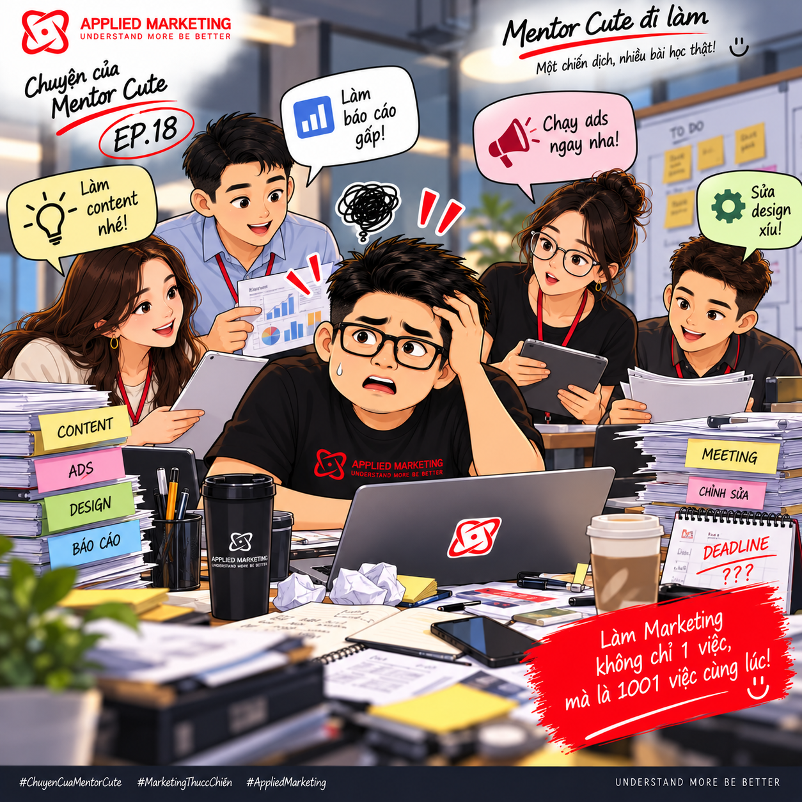

LÀM MARKETING KHÔNG CHỈ 1 VIỆC, MÀ LÀ 1001 VIỆC CÙNG LÚC! 🌀  
  
Chuyện của Mentor Cute · EP.18  
  
Khi bốn người cùng nhờ một lúc và ai cũng nói “gấp”, bạn nên làm việc nào trước?  
  
Theo mình, câu trả lời không nằm ở việc làm nhanh hơn, mà ở việc chọn đúng thứ tự.  
  
“Làm nội dung nhé!” “Làm báo cáo gấp!” “Chạy quảng cáo ngay nha!” “Sửa thiết kế xíu!” Bốn giọng nói vang lên cùng lúc, Mentor Cute ngồi giữa chồng hồ sơ dán nhãn Nội dung, Quảng cáo, Thiết kế, Báo cáo, Họp, Chỉnh sửa, và tờ lịch ghi “DEADLINE ???”. 😵 (“1001 việc” chỉ là cách nói vui, nhưng cảm giác thì ai làm marketing cũng quen.)  
  
1. Khi cái gì cũng gấp, ta dễ làm theo tiếng ai to hơn.  
  
Cuối ngày bạn mệt rã rời, còn việc quan trọng thì vẫn nằm đó chưa xong.  
  
2. Quy trình 5 bước để bớt rối (kinh nghiệm cá nhân, bạn chọn cái hợp với mình).  
  
Gom: ghi mọi yêu cầu vào một chỗ duy nhất, không nhớ trong đầu. Ghi rõ ai nhờ, nhờ gì, khi nào cần.  
Hỏi hạn chót thật: “gấp” là trước giờ nào hôm nay? Nhiều khi “gấp” chỉ là cảm giác của người nhờ.  
Chia hai trục quan trọng và khẩn cấp: việc vừa quan trọng vừa khẩn cấp làm trước; việc quan trọng nhưng chưa gấp thì đặt lịch; việc khẩn cấp mà ít quan trọng thì nhờ người khác hoặc gom làm một lượt.  
Nói rõ khi quá tải: đưa danh sách cho sếp và hỏi “việc nào em làm trước ạ?”. Chọn thứ tự là việc của cả hai bên.  
Giữ một khoảng không bị làm phiền (ví dụ giả định: một đến hai tiếng mỗi sáng) cho việc quan trọng.  
  
3. Dám nói “để sau” cũng là một kỹ năng chuyên môn.  
  
Michael Porter, giáo sư Harvard, trong bài “What Is Strategy?” năm 1996 viết rằng cốt lõi của chiến lược là chọn điều không làm: “The essence of strategy is choosing what not to do.” Với dân marketing đang ngập việc, nói “để sau” hay “không” với những việc không phục vụ mục tiêu chính là một quyết định chiến lược, không phải sự lười biếng.  
  
Việc nên làm hôm nay: ghi tất cả việc đang có vào một danh sách và chọn ra đúng ba việc quan trọng cho hôm nay.  
  
Làm marketing là nhiều việc cùng lúc, nhưng có thứ tự thì sẽ nhẹ đi rất nhiều. Hôm nay bạn đang có mấy việc “gấp” trong tay? Kể mình nghe với nha 👇  
  
---------------------------------  
💎 Applied Marketing – Mentor Xờ & Chạm Marketing  
📞 Hotline & Zalo: 033 955 7573  
🌐 Website: appliedmarketer.com  
#AppliedMarketing #MarketingThucChien #ContentMarketing #Content #DigitalMarketing #HocMarketing #Branding #BrandStrategy

---

## EP.19 · 25/11/2026 lúc 10:00 (bài 33)

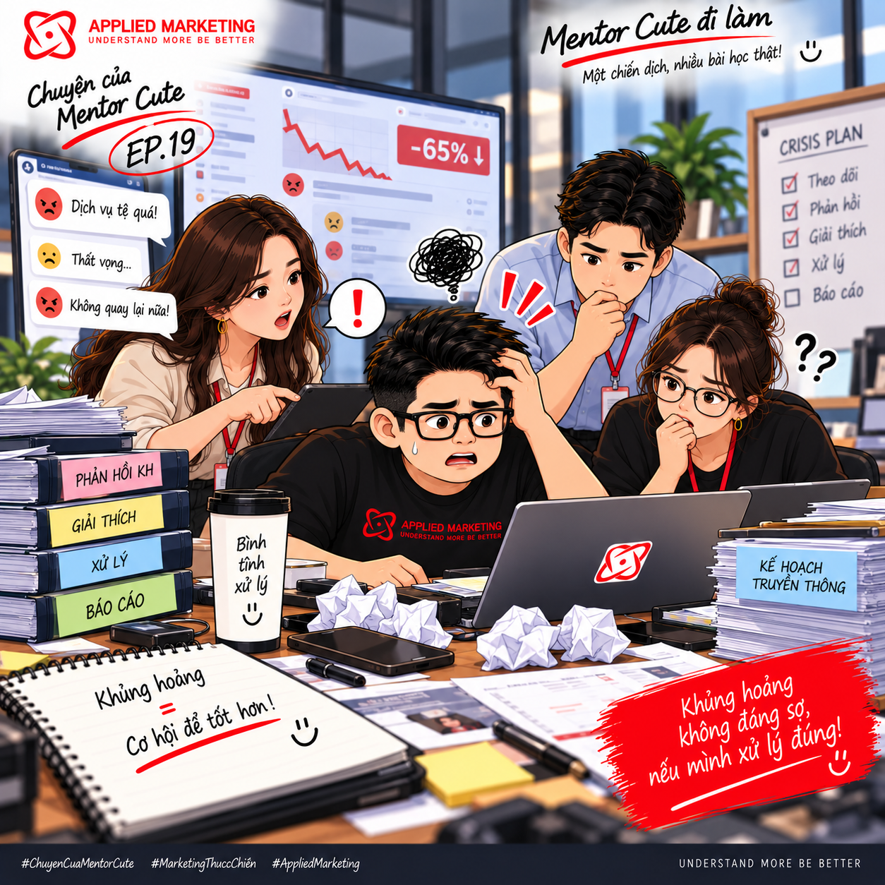

KHỦNG HOẢNG TRUYỀN THÔNG: KHÔNG ĐÁNG SỢ NẾU MÌNH XỬ LÝ ĐÚNG 🚨  
  
Chuyện của Mentor Cute · EP.19  
  
Khi bình luận tiêu cực ập đến, xóa đi, cãi lại hay im lặng: cách nào ổn?  
  
Theo mình, cả ba đều dễ làm tình hình tệ hơn, vì khách sẽ thấy mình không được lắng nghe.  
  
Một ngày nọ: “Dịch vụ tệ quá!”, “Thất vọng…”, “Không quay lại nữa!”. Biểu đồ đi xuống (số liệu trong hình là số giả định, chỉ mang tính tham khảo). Cả đội nhìn nhau, còn Mentor Cute đổ mồ hôi nhưng vẫn nhắc mình: bình tĩnh xử lý.  
  
Vậy nên làm gì? Mình chia theo từng giai đoạn để dễ áp dụng. (Đây là kinh nghiệm cá nhân, không phải quy chuẩn bắt buộc.)  
  
1. Giai đoạn đầu, trong vài giờ đầu: theo dõi và phản hồi.  
  
Gom các bình luận và tin nhắn vào một chỗ. Xem chuyện gì đang xảy ra, ai bị ảnh hưởng, mức độ lan rộng. Trả lời sớm, ngắn gọn, tôn trọng, ghi nhận cảm xúc của khách và tránh đổ lỗi.  
  
2. Giai đoạn giữa, khi đã nắm tình hình: giải thích và xử lý.  
  
Nói điều mình đã biết, điều đang kiểm tra và khi nào sẽ cập nhật tiếp. Không đoán, không hứa điều chưa chắc. Sau đó làm bằng hành động thật như sửa lỗi, đền bù hợp lý, liên hệ riêng với khách bị ảnh hưởng. Nếu liên quan đến pháp lý hoặc an toàn của khách, hãy trao đổi thêm với bộ phận hoặc chuyên gia phụ trách trước khi đăng lời giải thích.  
  
3. Giai đoạn sau, khi mọi thứ lắng xuống: báo cáo và rút kinh nghiệm.  
  
Ghi lại chuyện đã xảy ra, cách xử lý, và điều cần đổi để lần sau không lặp lại. Soạn trước một bản kế hoạch, ghi rõ ai làm gì và ai được phép trả lời, để lần sau không phải lo trong hoảng loạn.  
  
Về chuyện lấy niềm tin của khách làm gốc, ngày 05/09/2007, sau khi Apple giảm giá iPhone chưa đầy ba tháng sau ngày ra mắt, Steve Jobs đã gửi thư cho khách hàng. Trong thư có những dòng như “We want to do the right thing for our valued iPhone customers” và “Our early customers trusted us, and we must live up to that trust with our actions in moments like these.” Tạm hiểu là: những người đến với mình từ sớm đã đặt niềm tin vào mình, và ở những lúc như thế này mình phải đáp lại bằng việc làm, không phải bằng lời. Khủng hoảng thường là lúc bài kiểm tra niềm tin được diễn ra.  
  
Việc nên làm hôm nay: soạn trước một bản kế hoạch 3 giai đoạn cho doanh nghiệp của bạn.  
  
Khủng hoảng không đáng sợ nếu mình xử lý đúng, và đôi khi còn là cơ hội để thương hiệu tốt hơn. Theo bạn, bước nào quan trọng khi gặp phản hồi tiêu cực? Comment cho mình biết nha 👇  
  
---------------------------------  
💎 Applied Marketing – Mentor Xờ & Chạm Marketing  
📞 Hotline & Zalo: 033 955 7573  
🌐 Website: appliedmarketer.com  
#AppliedMarketing #MarketingThucChien #ContentMarketing #Content #DigitalMarketing #HocMarketing #Branding #BrandStrategy

---

## EP.20 · 25/11/2026 lúc 20:00 (bài 34)

SEASON 2 COMPLETE: LÀM MARKETING VẪN NHIỀU THỬ THÁCH NHƯNG THẬT ĐÁNG GIÁ! 🎉  
  
Chuyện của Mentor Cute · EP.20  
  
Mentor Cute giơ nắm tay ăn mừng, cả đội vỗ tay rộn ràng: Season 2 hoàn thành! 20 tập, nhiều bài học, nhiều trải nghiệm.  
  
Trước (Before): ở tập đầu, Mentor Cute cầm một brief đòi tất cả mọi thứ và chưa biết bắt đầu từ đâu. Hai mùa sau, bao nhiêu tình huống rất quen với người làm marketing: brief mơ hồ, bài ít người xem, số đẹp mà chưa có khách, sếp hỏi “Lead đâu?”, đổi ý phút chót, làm việc với agency, góp ý liên tục, nhiều việc cùng lúc và cả khủng hoảng.  
  
Sau (After): vẫn là Mentor Cute của ngày đầu, nhưng biết hỏi trước khi làm, nhìn số theo từng chặng, và coi mỗi lần vấp là một lần hiểu thêm.  
  
Cầu nối (Bridge): 5 điều Mentor giữ lại để áp dụng.  
1. Hỏi trước khi làm: brief mơ hồ thì làm rõ mục tiêu, nhóm khách, ngân sách, chỉ tiêu.  
2. Hiểu khách hàng trước khi chọn kênh hay chiêu thức.  
3. Đo theo kết quả cuối, không chỉ theo chỉ số bề mặt; gặp vấn đề thì tìm đúng chặng đang tụt.  
4. Phối hợp rõ ràng với sếp, đồng nghiệp, agency: tiêu chí duyệt, số vòng sửa, tiến độ.  
5. Sau mỗi lần làm, ngồi lại rút kinh nghiệm để lần sau tốt hơn.  
  
Đó cũng là tinh thần Applied Marketing: hiểu đúng, làm đúng, kết quả thật.  
  
Mình xin khép lại bằng câu mà Steve Jobs để lại cho sinh viên Đại học Stanford năm 2005. Ông kể trên bìa sau một số cuối của cuốn The Whole Earth Catalog có dòng chữ “Stay Hungry. Stay Foolish.” và nói thêm: “And I have always wished that for myself.” Hãy luôn khao khát, hãy luôn dám khờ dại; và ông vẫn mong điều ấy cho chính mình. Với người làm marketing, đó là lời nhắc đừng ngừng tò mò, và đừng sợ thử cái mới dù chưa chắc thắng.  
  
Việc nên làm hôm nay: chọn một trong 5 điều trên, áp dụng cho dự án đang làm, rồi quay lại kể kết quả cho mình nhé.  
  
Cảm ơn mọi người đã đồng hành cùng Mentor Cute ở Season 2. Hẹn gặp lại ở Season 3, sẽ còn nhiều điều mới! 💌 Tập nào trong 20 tập bạn thấy giống mình? Comment cho mình biết nha 👇  
  
---------------------------------  
💎 Applied Marketing – Mentor Xờ & Chạm Marketing  
📞 Hotline & Zalo: 033 955 7573  
🌐 Website: appliedmarketer.com  
#AppliedMarketing #MarketingThucChien #ContentMarketing #Content #DigitalMarketing #HocMarketing #Branding #BrandStrategy

---
